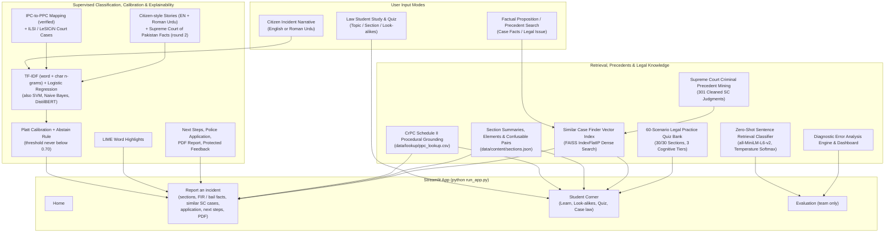

# AI Legal Helper for Pakistan

### Machine Learning for Pakistani Criminal Law: Offence Classification, Precedent Retrieval & Legal Education

**Course:** Machine Learning (5th Semester BS Computer Science)

> Legal information, not legal advice. The app always says so and points to the free legal-aid helpline **1099**.

---

# PART I: TECHNICAL REPORT & SYSTEM ARCHITECTURE

## 1. Executive Summary & Problem Formulation

In Pakistan, access to justice is severely impeded by three structural barriers:

1. **Linguistic & Terminology Divide:** Pakistani penal law is codified in archaic 19th-century Victorian English (Pakistan Penal Code, Act XLV of 1860). Ordinary citizens, however, narrate grievances in informal English or conversational Roman Urdu (e.g., _"mera mobile cheen liya"_, _"cheque bounce ho gaya"_), making statutory navigation inaccessible without costly initial legal consultation.
2. **Procedural Complexity (CrPC Schedule II):** Identifying an applicable penal section is only half the battle. A victim must know their immediate procedural rights: whether police are mandated to register a First Information Report (FIR) without a warrant (**Cognizable** vs. **Non-cognizable**), whether the accused can demand release as a matter of right (**Bailable** vs. **Non-bailable**), whether private compromise is legally lawful (**Compoundable** vs. **Non-compoundable**), and which court has competent jurisdiction.
3. **Statutory Ambiguity & Confusable Offence Boundaries:** Pakistani criminal law contains subtle, high-stakes statutory boundaries that challenge junior advocates and law students alike. For example:
   - _Theft (s. 379)_ vs. _Theft with preparation for hurt (s. 382)_ vs. _Robbery (s. 392)_ vs. _Dacoity (s. 395)_.
   - _Bodily Hurt to Head/Face (Shajjah, s. 337-A)_ vs. _Bodily Hurt to Body Cavities/Limbs (Ghayr-Jaifah, s. 337-F)_ under the Qisas & Diyat Act of 1997.
   - _Dishonest Cheque Issuance (s. 489-F)_ vs. _Cheating & Fraud (s. 420)_.

### Solution Overview

**AI Legal Helper for Pakistan** is an end-to-end machine learning system that bridges this gap. It combines:

- **Calibrated multi-label classification** that maps informal citizen narratives in English and Roman Urdu to 30 core PPC sections, with explanations (LIME), a calibrated confidence and an **abstain rule**: when it is not confident it asks for more detail instead of guessing.
- **Zero-Shot Semantic Retrieval** utilizing dense sentence-transformer embeddings (`all-MiniLM-L6-v2`) to perform semantic section matching with zero labelled training pairs.
- **High-Dimensional Precedent Mining** utilizing Facebook AI Similarity Search (`FAISS IndexFlatIP`) to retrieve real Supreme Court of Pakistan criminal appeal precedents in $< 7\text{ ms}$.
- **Citizen tools:** next steps under the CrPC (FIR s.154, non-cognizable route s.155/200, refusal remedy s.22-A), helplines for every province, a ready-to-sign **written application to the police (darkhwast)** in English and Urdu, and a **PDF report** with correct Urdu right-to-left layout.
- **Student Corner:** learn the 30 offences topic by topic, compare look-alike sections, a practice quiz with setup and a results screen, and Supreme Court case-law search.
- **Evaluation & error analysis** on a held-out test set, kept for the team and examiners.

---

## 2. System Architecture



---

## 3. Statutory Taxonomy & CrPC Schedule II Grounding

The platform models **30 core Pakistan Penal Code (Act XLV of 1860) sections**, strictly grounded in the procedural schedule of the **Code of Criminal Procedure (Act V of 1898), Schedule II**:

| Category                                 | PPC Sections Included                                    | Key Statutory Focus                                                                                                              |
| ---------------------------------------- | -------------------------------------------------------- | -------------------------------------------------------------------------------------------------------------------------------- |
| **Offences Affecting the Human Body**    | `302`, `307`, `319`, `324`, `337-A`, `337-F`, `339`      | Qatl-i-amd (murder), attempt to murder (pre-1997 numbering), qatl-i-khata (killing by mistake), attempt to commit qatl, hurt (_Shajjah_ & _Jurh_), wrongful restraint                                    |
| **Confinement & Offences Against Women** | `340`, `354`, `354A`, `363`, `365`, `365-A`              | Wrongful confinement, outraging modesty, assault on woman stripping clothes, kidnapping for ransom                               |
| **Offences Against Property**            | `379`, `380`, `382`, `384`, `392`, `395`                 | Theft, dwelling theft, theft with preparation for hurt, extortion, robbery, dacoity                                              |
| **White-Collar Fraud & Trespass**        | `403`, `406`, `411`, `420`, `441`, `447`, `448`, `489-F` | Criminal misappropriation, criminal breach of trust, receiving stolen property, cheating, criminal trespass, dishonoured cheques |
| **Reputation & Criminal Intimidation**   | `500`, `506`, `509`                                      | Defamation, criminal intimidation, insulting modesty of women (Act I of 2010)                                                    |

### Procedural Posture & Criminal Enforcement Rules:

Every single predicted section is linked to verified legal attributes:

- **Cognizable:** Police have lawful authority to arrest without warrant and register an FIR immediately under Section 154 CrPC (e.g. s. 302, 392, 489-F).
- **Non-cognizable:** Police cannot arrest or investigate without a formal warrant/order from a Judicial Magistrate under Section 155 CrPC (e.g. s. 500 Defamation, s. 448 House-trespass).
- **Bailable:** Bail is a matter of statutory right upon furnishing solvent surety under Section 496 CrPC (e.g. s. 379, 411, 447).
- **Non-bailable:** Bail is a matter of judicial discretion governed by Section 497 CrPC (e.g. s. 302, 365-A, 392, 489-F).
- **Compoundable:** Victim or legal heirs (_Walis_) have lawful authority to record compromise/reconciliation (_Sulh_) to drop charges under Section 345 CrPC.

---

## 4. Machine Learning Methodology & Engineering Decisions

### 4.1 Data

| Data | Rows (train / val) | Source and how it was checked |
|---|---|---|
| Indian court case texts (ILSI / LeSICiN, CC BY 4.0) | 1,065 / 270 | IPC sections mapped to PPC with a verified mapping (`data/mapping/ipc_ppc_map.csv`, `docs/A1_verification_report.md`; traps such as IPC 307 → PPC 324 handled). Section numbers in the text masked as `[SEC]` |
| Citizen-style stories, English + Roman Urdu | 442 / 115 | Written with an AI assistant, sample legally reviewed (`docs/A3_review_log.md`) |
| WhatsApp-style Roman Urdu messages (round 2) | 224 / 56 | Messy chat spelling, both genders, two-offence cases; max similarity to any test message 0.47 (`docs/round2_data.md`) |
| Supreme Court of Pakistan facts passages (round 2) | 142 / 36 | Facts passage only (not the court header); every section number and "PPC" masked |
| **Total** | **1,873 / 477** | Grouped split, so near-duplicates never cross train/val |

### 4.2 Supervised Multi-Label Classifiers

- **Model Architectures Evaluated:** DistilBERT transformer (`distilbert-base-uncased`), Logistic Regression (One-vs-Rest), Linear Support Vector Machines (LinearSVC), and Complement Naive Bayes.
- **Feature Engineering:** Word n-grams (1–2) combined with **character n-grams (2–5, word-boundary)** via `FeatureUnion`, after a Roman Urdu normaliser that maps spelling variants and chat spellings to one form (`kl → kal`, `mn → mein`, `tw → to`, `mara → maara`; English look-alikes such as *men*, *may*, *fir* are deliberately not mapped).
- **Class Imbalance Mitigation:** `class_weight="balanced"`.
- **Model selection on validation only:** hyperparameters from a grid search (`results/tfidf_grid.csv`); the app uses TF-IDF + LR (C = 16). Round 2 kept the same hyperparameters so the gain measures the data only.
- **Calibration:** Platt scaling of the top-1 confidence, $\sigma(a \cdot \text{logit} + b)$, fitted on validation and checked with 2-fold cross-fitting (expected calibration error 0.23 → 0.12; reliability diagrams in `results/figures/`).
- **Abstain rule + safety floor:** the threshold is the lowest confidence at which answered cases reach 85% top-1 accuracy on validation, **but never below 0.70**. After round 2 the rule alone fell to 0.55 and the app started answering everyday complaints (a wrong birthday cake → "302 murder" at 66%); validation has no non-crime text, so the floor keeps the earlier safe value.
- **Explainability (LIME):** word-level highlights of what pushed the model towards or away from the top section (e.g. *"pistol"*, *"cheen"* → s. 392), with batched scoring (0.07 s).
- **Display-only legal conditions:** s.354 / 354-A apply only when the victim is a woman; s.509(ii) (sexual harassment) is gender-neutral. These notes never change the ranking or the metrics.

### 4.3 Zero-Shot Semantic Retrieval Classifier

- **Bi-Encoder Architecture:** Built on `sentence-transformers/all-MiniLM-L6-v2` (384-dimensional unit-normalized embeddings).
- **Composite Passage Construction:** Unlike simple title matching, each section is encoded using a composite statutory representation:
  $$\text{Passage}_s = \text{Section Title} \parallel \text{Legal Summary} \parallel \text{Elements of Offence} \parallel \text{Citizen Colloquial Terms}$$
- **Temperature-Scaled Softmax Scoring ($T=0.25$):** Cosine similarities are calibrated into probability distributions over the 30 classes:
  $$P(s \mid q) = \frac{\exp(\cos(\mathbf{e}_q, \mathbf{e}_s) / T)}{\sum_{s' \in \mathcal{S}} \exp(\cos(\mathbf{e}_q, \mathbf{e}_{s'}) / T)}$$
- **Zero-Shot Advantage:** Operates completely offline with zero labelled training pairs, delivering **93.3% Top-3 recall on English legal queries** (15-query English benchmark, `stub_test`; on the 162-message J1 test set: 41.4% top-1, 71.0% top-3, see §5.1).

### 4.4 Precedent Mining & Vector Index

- **Corpus:** 301 Supreme Court of Pakistan criminal appeals mined from raw judgments, cleaned and validated with 100% citation precision.
- **Vector Search Engine:** FAISS `IndexFlatIP` (Exact Cosine Inner Product search over 384-dimensional embeddings).
- **Two-Stage Hybrid Search:**
  1. _Stage 1 (Optional Metadata Filter):_ Filters the corpus candidates by cited PPC section.
  2. _Stage 2 (Dense Semantic Ranking):_ Computes dot product similarity between query narrative and case occurrence facts.
  3. _Latency:_ **$6.42\text{ ms}$** search latency on standard multi-core CPU.

### 4.5 Hybrid of the two models (tested, not adopted)

`w · LR + (1 − w) · retrieval`, with $w$ chosen on validation and an adoption rule fixed in advance (validation top-3 gain ≥ 2 points). With the round-2 model: $w = 0.7$, validation top-3 +1.1 points, test top-1 unchanged. **Not adopted**: the retrieval model is English-only (Roman Urdu top-1 22%) and adds little once the classifier has learned Roman Urdu (`docs/J2_hybrid.md`).

---

## 5. Experimental Results

### 5.1 Held-out test set (J1)

162 crime descriptions (104 English, 58 Roman Urdu) + 16 non-crime descriptions, **never used for training, model selection or calibration** (`docs/J1_test_set.md`, `docs/J1_results.md`).

| Model | Top-1 | Top-3 | Micro-F1 | Roman Urdu top-1 | Answers (coverage) | Top-1 when answering | Non-crime refused |
|---|:-:|:-:|:-:|:-:|:-:|:-:|:-:|
| **TF-IDF + LR (used by the app)** | **0.827** | **0.951** | 0.741 | **0.862** | **70%** | **0.920** | **16/16** |
| TF-IDF + Linear SVM | 0.846 | 0.944 | 0.770 | 0.879 | 70% | 0.930 | 15/16 |
| TF-IDF + Complement NB | 0.426 | 0.685 | 0.427 | 0.707 | 14% | 0.500 | 14/16 |
| DistilBERT (fine-tuned, round-1 data) | 0.611 | 0.864 | 0.586 | 0.552 | 18% | 0.966 | 16/16 |
| Zero-shot retrieval (MiniLM) | 0.414 | 0.710 | – | 0.224 | – | – | – |
| Hybrid (w = 0.7, not adopted) | 0.827 | 0.957 | – | 0.862 | – | – | – |

SVM is slightly ahead on the test set, but models are chosen on validation, never on the test set, so the app keeps LR.

### 5.2 Effect of the round-2 data (same test set, same LR settings)

| Configuration | Train rows | Top-1 | Top-3 | Roman Urdu top-1 |
|---|:-:|:-:|:-:|:-:|
| Round 1 (original data) | 1,507 | 0.765 | 0.877 | 0.690 |
| + chat-spelling normaliser | 1,507 | 0.765 | 0.883 | 0.690 |
| + Roman Urdu chat messages | 1,731 | 0.846 | 0.951 | 0.879 |
| + Supreme Court of Pakistan facts | 1,649 | 0.765 | 0.889 | 0.690 |
| **All (final, chosen on validation)** | **1,873** | **0.827** | **0.951** | **0.862** |

The app's model before → after: answers 58% → 70% of messages at about 92% top-1; non-crime refused 16/16 both times. The Pakistani court data does not help citizen messages but raises Pakistani court-text validation from 0.69 to 0.83, so it was kept (`results/round2_ablation.csv`).

### 5.3 Small English benchmark for the retrieval classifier

| Model Architecture | Evaluation Split / Language | Samples | Top-1 Accuracy | Top-3 Recall | Micro-F1 | Macro-F1 |
| --- | --- | :-: | :-: | :-: | :-: | :-: |
| **Zero-Shot Retrieval Classifier (B4)** | **Benchmark English (`stub_test`)** | 15 | **0.8000** | **0.9333** | 0.5294 | **0.7719** |
| **Zero-Shot Retrieval Classifier (B4)** | Benchmark All (`stub_test`) | 20 | 0.6500 | 0.8000 | 0.4494 | 0.7206 |
| **Stub Baseline (K4 Benchmark)** | Benchmark All (`stub_test`) | 20 | 0.1000 | 0.2000 | 0.0825 | 0.0825 |

### 5.4 Key Findings

1. **Character n-grams beat the transformer on Roman Urdu:** on the test set TF-IDF + LR reaches **86.2%** top-1 on Roman Urdu vs. DistilBERT's **55.2%**. Roman Urdu has no standard spelling (*chori*, *chori karna*, *chori hogai*); sub-word tokenizers break such words apart, while character 2–5-grams capture the stable parts.
2. **Zero-Shot Semantic Retrieval on Legal Paraphrasing:** The `all-MiniLM-L6-v2` bi-encoder achieved **93.3% Top-3 recall** on the 15-query English benchmark without any supervised pairs; on citizen-style Roman Urdu it is weak (22% top-1), because the encoder is English-only.
3. **Statutory Boundary Confusion Patterns:** Diagnostic error analysis (`src/error_analysis.py`) revealed that misclassifications align closely with legitimate human statutory confusions (e.g. Theft 379 vs. Robbery 392, Hurt 337-A vs. 337-F), validating the need for the **Look-alike sections** module in the UI.
4. **Data mattered more than model choice:** the largest single gain came from 224 realistic Roman Urdu messages (+8 points top-1, +19 points Roman Urdu), not from a bigger model.
5. **Safe but cautious:** in a hands-on check with 8 messages written by real people, the model gave 0 wrong answers (all 5 non-crime messages refused, 1 of 3 crimes answered correctly, 2 refused with the right top guess).

---

# PART II: USER MANUAL & OPERATION GUIDE

## 6. System Requirements & Installation

### 6.1 Prerequisites

- **Operating System:** Windows 10/11, macOS, or Ubuntu/Linux
- **Python Version:** Python 3.10 to 3.14 (x64)
- **RAM:** Minimum 4 GB (8 GB recommended)
- **Disk Space:** ~1.5 GB for dependencies, models, and FAISS indices

### 6.2 Step-by-Step Installation

1. **Clone the Repository:**

   ```bash
   git clone https://github.com/abdulqudoos181005/AI-Legal-Helper-for-Pakistan.git
   cd AI-Legal-Helper-for-Pakistan
   ```

2. **Create & Activate Virtual Environment:**

   ```bash
   # Windows PowerShell
   python -m venv .venv
   .\.venv\Scripts\Activate.ps1

   # Linux / macOS
   python3 -m venv .venv
   source .venv/bin/activate
   ```

3. **Install Dependencies:**

   ```bash
   pip install -r requirements.txt
   ```

4. **Verify Offline Sentence Transformers Environment:**
   To guarantee rapid offline startup without HuggingFace network retries, set the environment variables in your terminal:

   ```bash
   # Windows PowerShell
   $env:HF_HUB_OFFLINE = "1"
   $env:TRANSFORMERS_OFFLINE = "1"

   # Linux / macOS
   export HF_HUB_OFFLINE=1
   export TRANSFORMERS_OFFLINE=1
   ```

---

## 7. Launching the Software

```bash
python run_app.py
```

_Alternative direct command:_ `python -m streamlit run app/Home.py`, then open **`http://localhost:8501`**.

- **First start on a new machine:** the trained model files are not stored in git, so the app trains the classifier itself (about 25 seconds to 1 minute) while a loader is shown.
- **After pulling new data:** run `python -m src.models.retrain` once so saved models match the current data.
- **Evaluation page (team / examiners only):** `$env:LEGAL_HELPER_ADMIN="1"; python run_app.py` (PowerShell) or `LEGAL_HELPER_ADMIN=1 python run_app.py`.

---

## 8. Application Walkthrough

### 🏠 Home
Welcome, what the app can do, an honest warning that it can be wrong, emergency numbers, and two entry points: **"I need legal help"** and **"I'm a law student"**. The sidebar has the menu, a light/dark switch and **helplines for every province** (national numbers plus Punjab, Sindh, Khyber Pakhtunkhwa, Balochistan and Islamabad; each number has a source in `data/lookup/helplines.csv`).

### 🚨 Report an incident
_For citizens._ Type what happened in English, Roman Urdu or a mix and press **Enter** (Shift+Enter for a new line).

```text
[Description] ──► [Roman Urdu normaliser] ──► [TF-IDF + LR] ──► [Calibrated confidence]
                                                                     │
                         below 0.70: ◄───────────────────────────────┴──────────────► 0.70 or more:
                 "I need more detail" + what to add                    top sections + FIR / bail / settlement facts
                 (no legal route, no FIR advice)                       + similar Supreme Court cases + next steps
```

- **Sections that may apply:** up to 3 cards with High / Medium / Low confidence, punishment, and badges (police can register an FIR or not, bailable or not, can be settled or not). Weak guesses (< 40%) are listed in one line, not as cards.
- **Legal condition notes:** e.g. s.354 applies only when the victim is a woman.
- **Look-alike warning** when the top two sections are commonly confused.
- **Why this result? (LIME)** word highlights.
- **🏛️ Similar Supreme Court cases** from the FAISS index, with the judgment excerpt.
- **📝 Application to the police (darkhwast):** police write the FIR themselves (s.154 CrPC); this fills a standard application with the user's details, in English and/or Urdu, ready to print and sign.
- **What to do now:** only the route that fits (FIR for cognizable, Magistrate for non-cognizable), what to do if police refuse (senior officers, provincial complaint lines, s.22-A CrPC), evidence and free legal advice.
- **⬇️ PDF report** with the analysis, steps, helplines for the chosen province and the application (Urdu shaped and right-to-left).
- **Feedback that cannot poison the model:** thumbs up/down; corrections from lawyers and law students need a Bar Council licence / enrolment number (or university and roll number) and a legal reason, are saved as *unverified*, and are **never used automatically**; only team-verified corrections may ever be used for retraining. Max 3 per session; the incident text is stored only with consent.
- **When the model is not confident** it shows no sections and no legal route: it asks for the missing details, or says plainly that the model has not seen enough examples like it, and points to **1099**.

### 🎓 Student Corner
_For law students._

1. **📚 Learn:** jump to any section, or pick a topic (body and life, liberty and kidnapping, protection of women, theft and robbery, fraud and cheques, land and trespass, threats and defamation). Each section shows its plain-language summary, what the prosecution must prove, an example, punishment, court, CrPC badges, sections it is often confused with, and how many Supreme Court judgments in the collection cite it. Buttons: **Quiz me on this topic** and **Compare look-alikes**.
2. **⚖️ Look-alikes:** the **10 confusable groups** with the key difference, a side-by-side table and the common student mistake.
3. **📝 Quiz:** choose topic, difficulty and number of questions first; check each answer with a legal explanation; an optional running score; a results screen at the end with a per-topic breakdown and a review of every mistake. (2 of the 60 questions are hidden because their marked answer treats s.319 as hurt; see `docs/content_fixes.md`.)
4. **🏛️ Case law:** semantic search over **301 Supreme Court of Pakistan** criminal judgments, with an optional section filter and 1–10 results.

### 📊 Evaluation (team only)
Leaderboard, error analysis and confusion pairs, a misclassification inspector, and the raw grids, ablations and calibration files. Hidden from normal users (see §7).

---

# PART III: VERIFICATION, TESTING & CLI TOOLS

## 9. Automated Testing

**79 pytest tests** (`python -m pytest tests -q`) cover the IPC→PPC mapping, data parsing and masking, the Roman Urdu normaliser, the analyzer and abstain rule, LIME, the police application, feedback and the Urdu PDF layout, round-2 data checks (no copying of the test set, no leaked section numbers, safety floor), and headless tests of every app page (Home, Report an incident, Student Corner quiz flow, hidden Evaluation, province helplines).

Standalone verification harnesses for the knowledge base, retrieval and precedent index:

| Test Harness                 | File Path                      | Assertions | Invariants Enforced                                                        |
| ---------------------------- | ------------------------------ | :--------: | -------------------------------------------------------------------------- |
| **Label Space Integrity**    | `tests/test_labels.py`         |     8      | 30 PPC sections, schema, categories, confusable cross-references           |
| **Lookup Table Integrity**   | `tests/test_lookup.py`         |     8      | CrPC Schedule II procedural facts, bailability, compounding                |
| **Section Content & Groups** | `tests/test_content.py`        |     8      | Plain-English summaries, prosecution elements, 10 confusable groups        |
| **Supreme Court Corpus**     | `tests/test_sc_clean.py`       |     12     | 301 SC criminal judgments, citation regex precision $\ge 90\%$             |
| **Retrieval Classifier**     | `tests/test_retrieval.py`      |     12     | Embedding shape `(30, 384)`, K4 contract, softmax calibration              |
| **FAISS Precedent Finder**   | `tests/test_case_finder.py`    |     10     | Vector index shape `(301, 384)`, similarity bounds, latency $<50\text{ms}$ |
| **Quiz Bank Integrity**      | `tests/test_quiz_bank.py`      |     10     | 60 questions, 30/30 section coverage, schema, 4-option uniqueness          |
| **Student UI Integration**   | `tests/test_student_pages.py`  |     6      | Headless `AppTest` for Pages 2, 3, 4 (filters, state, zero crashes)        |
| **Error Analysis & Page 5**  | `tests/test_error_analysis.py` |     6      | Error analysis engine schema, bounds $[0, 1]$, Page 5 headless render      |

```bash
# Standalone harness scripts (run each file directly)
python -c "
import subprocess, sys
tests = [
    'tests/test_labels.py',
    'tests/test_lookup.py',
    'tests/test_content.py',
    'tests/test_sc_clean.py',
    'tests/test_retrieval.py',
    'tests/test_case_finder.py',
    'tests/test_quiz_bank.py',
    'tests/test_student_pages.py',
    'tests/test_error_analysis.py'
]
for t in tests:
    res = subprocess.run([sys.executable, t], capture_output=True, text=True)
    assert res.returncode == 0, f'Failed {t}:\n{res.stdout}\n{res.stderr}'
    print(f'✅ {t} PASSED')
print('\n🎉 All 9 test suites passing with 100% success!')
"
```

---

## 10. CLI Tools & Script Reference

### 1. Model Evaluation Engine (`src/evaluate.py`)

Evaluate any K4 model on any evaluation dataset CSV:

```bash
python src/evaluate.py --model retrieval --test-data data/test/stub_test.csv --top-k 3
python src/evaluate.py --model tfidf_lr --test-data data/test/stub_test.csv --top-k 3
```

### 2. Diagnostic Error Analysis Engine (`src/error_analysis.py`)

Generate per-class metrics, confusion pairs, and failure cases exported to JSON:

```bash
python src/error_analysis.py --model retrieval --test-data data/test/stub_test.csv --output-dir results
```

### 3. Precedent Vector Search CLI (`src/case_finder.py`)

Search Supreme Court judgments directly from the command line:

```bash
python -c "
from src.case_finder import search_cases
cases = search_cases('Accused fired upon complainant party with firearm', top_k=2)
for c in cases:
    print(f'[{c[\"citation_number\"]}] {c[\"case_title\"]} (Sim: {c[\"similarity\"]*100:.1f}%)')
"
```

### 4. Classical Model Training & Grid Search (`src/models/classical.py`)

Train and re-generate `tfidf_lr.joblib`, `tfidf_svm.joblib`, and `tfidf_nb.joblib`:

```bash
python -m src.models.classical --grid
```

### 5. Held-out test, calibration and data pipeline

```bash
python -m src.data.sc_facts          # Supreme Court of Pakistan facts passages (masked)
python -m src.data.make_splits       # train/val split (original rows unchanged)
python -m src.models.retrain         # retrain LR / SVM / NB with the grid-search settings
python -m src.calibration --model tfidf_lr
python -m src.evaluate_test          # J1 held-out test -> docs/J1_results.md
python -m src.round2_ablation        # effect of each round-2 change
python -m src.hybrid                 # J2 hybrid with the retrieval model
python -m src.quick_check check.txt  # run your own messages (one per line) through the app's model
```

---

## 11. Limitations

- **Small training data, and the citizen-style part is AI-written.** 1,873 training rows; the citizen-style stories and chat messages were written with an AI assistant and reviewed. Real Pakistani text comes only from 142 Supreme Court judgments; the largest part is Indian court text mapped from IPC to PPC.
- **Safe but cautious.** The model answers 70% of test messages; it sometimes refuses real crimes it could have answered.
- **No "not a crime" class.** The classifier must pick one of the 30 offences; the abstain threshold stops most everyday complaints but not all (e.g. a rent increase got s.339 at 74%). A separate crime / not-a-crime gate was tried and is not good enough yet with 140 non-crime examples (`results/crime_gate.json`).
- **Known reasoning gaps** (bag-of-words model): it cannot count people (4 robbers → dacoity, which needs 5 or more), can confuse who did what to whom (a man touched by a woman → s.354), and with several offences in one story (entered + hurt + stole) it may pick the wrong one.
- **Only 30 PPC sections.** Special laws that often appear in FIRs (PECA 2016, workplace harassment, Arms Ordinance), road-accident deaths (s.320), forgery and rape are out of scope.
- **The retrieval model is English-only** 
- **Urdu script input** is not supported yet (Roman Urdu and English only).

## 12. Future Work

1. **Deployment** for real users (Streamlit Community Cloud), with the feedback token and admin key as secrets.
2. **Real data:** collect prompted and spontaneous messages from real people (split by person; including non-crime problems) and verified expert corrections from the app, then retrain and report a real-user score.
3. **"Your rights" card (Constitution):** rule-based, with sources: Art. 9 (life and liberty), Art. 10 (grounds of arrest, a lawyer, a magistrate within 24 hours), Art. 10A (fair trial), Art. 13, Art. 14 (no torture), Art. 25, and the habeas corpus route (Art. 199) for illegal detention. FIRs cite offence sections, not Constitution articles; the Constitution is used for rights, writs and bail. Court routes must be re-checked after the 26th (2024) and 27th (2025) amendments.
4. **RAG in the Student Corner:** answers to students' questions retrieved from the actual text of the PPC, CrPC, Constitution and Supreme Court judgments, always with citations to the passage used, and "I don't know" when nothing relevant is found.
5. **Crime / not-a-crime gate** trained on several hundred varied non-crime messages.
6. **Special laws and more sections:** PECA 2016, workplace harassment, acid attacks (s.336-A/B), road accidents (s.320), forgery.
7. **Better models:** a multilingual sentence encoder for Roman Urdu retrieval, and rules for counts and roles (e.g. 5+ people for dacoity).
8. **Urdu script input** and an Urdu interface.

## 13. Legal Disclaimer

> [!WARNING]
>
> ### Official Legal Disclaimer & Guardrails
>
> 1. **Informational & Educational Use Only:** This platform is an educational and legal literacy aid developed for an academic Machine Learning project. It **does not constitute legal advice** and does not create an advocate-client relationship.
> 2. **Verification by Licensed Advocates:** Statutory provisions and procedural rights must always be verified by an advocate of the High Court or District Bar before filing formal legal petitions.
> 3. **Non-Judgmental & Impartial AI:** Predictions are mathematical correlations derived from statutory text and precedent patterns. The system does not assess the credibility or guilt of parties.
> 4. **Emergency Contact:** In situations involving imminent threat to life, domestic violence, or serious crimes, citizens should immediately contact the **Police Emergency Helpline (15)** or the **Ministry of Human Rights Free Legal Aid Helpline (1099)**.

---

## 14. Repository & Development

- **Branches:** each feature is developed on a branch and merged into `main` through pull requests with merge commits, so the full history stays visible.
- **Tests:** all tests pass before a merge (`python -m pytest tests -q`).
- **Not in git:** trained model weights, the DistilBERT checkpoint and private feedback (`data/feedback/`); the app retrains the classifier on first start.
- **Detailed reports:** `docs/` (mapping verification, data reports, J1 test set and results, J2 hybrid, round-2 data, content fixes, demo examples) and the task trackers / decision logs.

---

Developed by Abdul Qudoos and Sadia Fatima, BS Computer Science, Machine Learning course project.
