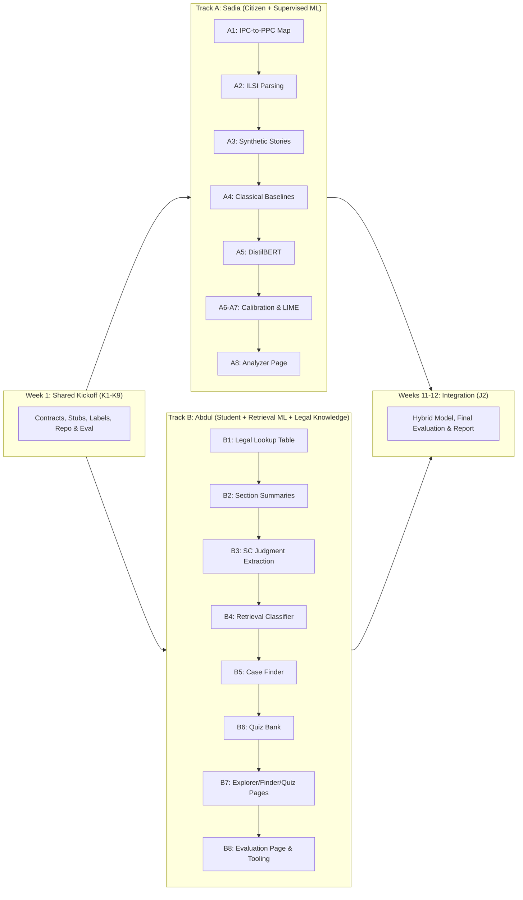
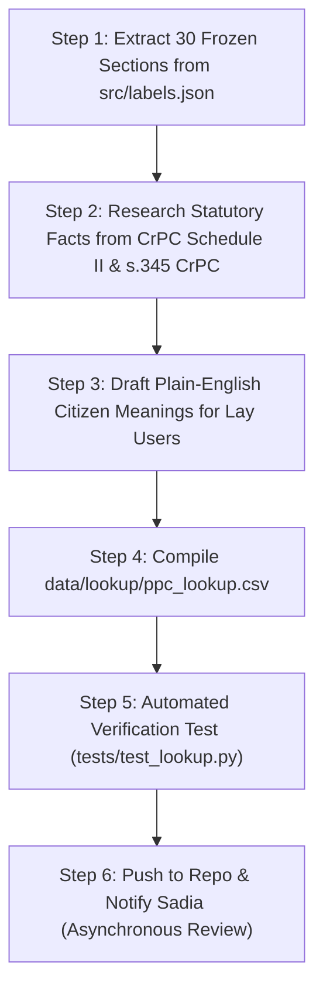
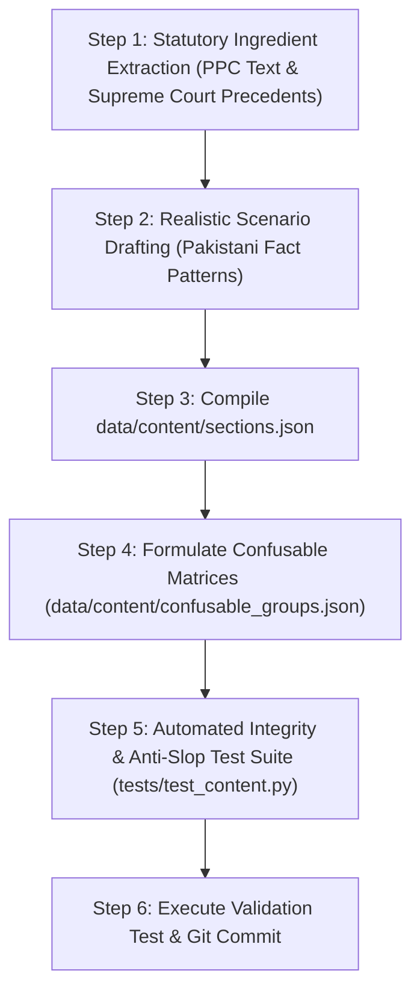
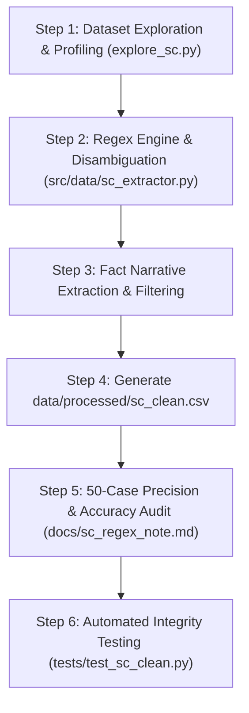
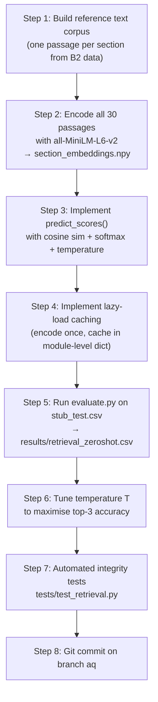
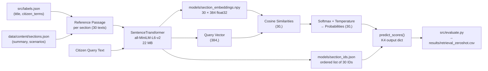
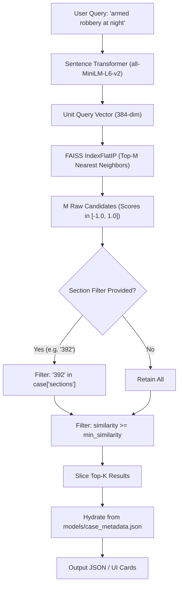
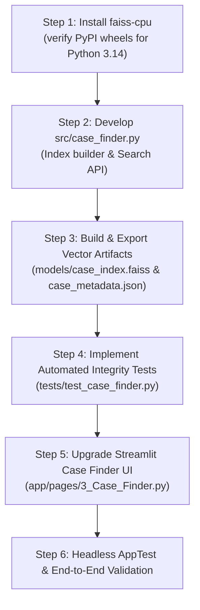
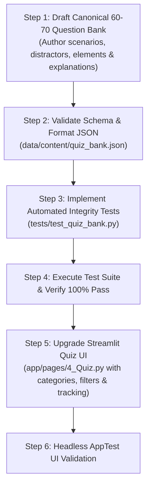
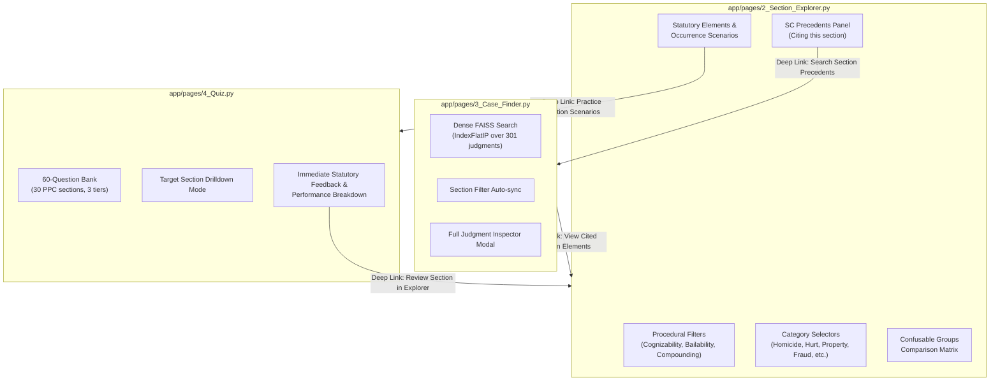

# AI Legal Helper for Pakistan — Implementation Plan (Abdul Qudoos)

**Author:** Abdul Qudoos  
**Collaborator:** Sadia Fatima  
**Course:** Machine Learning (5th Semester BS Computer Science)  
**Document Purpose:** Master execution roadmap for Abdul Qudoos's responsibilities under the **Two Independent Tracks** task division, including kickoff status, track roadmap, and the concrete implementation plan for the next task (**Task B1: Legal Lookup Table**).

---

## 1. Track Architecture & Core Responsibilities

Under the updated task division, the project is structured into two completely independent, parallel tracks designed to eliminate cross-dependencies:



### Abdul Qudoos's Scope (Track B):
1. **Legal Knowledge Foundation:** Authoring the authoritative CrPC Schedule II lookup table (B1), plain-English section summaries, elements of offence, and confusable pair taxonomies (B2).
2. **Supreme Court Judgment Mining:** Exploration and regex-based section citation extraction on Pakistan SC judgments (B3).
3. **Retrieval-Based ML & Case Search:** Building zero-shot sentence-embedding retrieval classifier for section recommendation (B4) and FAISS-based Similar Case Finder (B5).
4. **Student Educational Suite:** Authoring a 60–100 scenario quiz bank (B6) and developing the Streamlit Section Explorer, Case Finder, and Quiz pages (B7).
5. **Evaluation Suite & Error Analysis:** Developing the model evaluation dashboard and comparative error analysis tooling (B8).
6. **Shared Deliverables:** Co-collecting and labelling the real-person test set (J1), and co-building the hybrid model and final defense materials (J2).

---

## 2. Master Task Matrix for Abdul Qudoos

| Task ID | Phase / Weeks | Task Name | Type | Hours | Deliverables | Dependencies / Hand-offs |
| :--- | :---: | :--- | :--- | :---: | :--- | :--- |
| **K1–K9** | **Week 1** | **Shared Kickoff, Contracts & Stubs** | **Setup + ML** | **8h** | Repo, `labels.json`, stubs, `evaluate.py`, app skeleton | Shared with Sadia |
| **B1** | **Weeks 2–3** | **Legal Lookup Table (CrPC Schedule II)** | **Manual / Legal** | **12h** | `data/lookup/ppc_lookup.csv` (all 30 sections) | None (Sadia consumes in Wk 9) |
| **B2** | Weeks 3–4 | Section Summaries, Elements & Confusable Groups | Manual / Legal | 10h | `data/content/sections.json`, `confusable_groups.json` | B1 |
| **B3** | Weeks 4–5 | Supreme Court Judgments Exploration & Regex Extraction | ML (Data) | 10h | `data/processed/sc_clean.csv`, regex precision report | K2 |
| **B4** | Weeks 5–6 | Retrieval Classifier (Sentence Embeddings) | ML | 12h | `src/retrieval.py`, zero-shot results CSV | B2, K7 |
| **J1** | Weeks 6–9 | Real-Person Test Set (Abdul's Half: 100 En + 30 Roman) | Manual | 6h | Part of `data/test/real_test.csv` (frozen) | K2 |
| **B5** | Week 7 | Similar Case Finder (FAISS / Vector Index) | ML | 8h | `src/case_finder.py`, semantic case search API | B3 |
| **B6** | Week 8 | Quiz Bank (60 to 100 Scenarios) | Manual | 10h | `data/content/quiz_bank.json` | B2 |
| **B7** | Weeks 9–10 | Student App Pages (Explorer, Case Finder, Quiz) | App Dev | 14h | `app/pages/2_Section_Explorer.py`, `3_Case_Finder.py`, `4_Quiz.py` | B1, B2, B5, B6 |
| **B8** | Week 10 | Evaluation Page & Error Analysis Tooling | ML + App | 8h | `app/pages/5_Evaluation.py`, `src/error_analysis.py` | K6, K7 |
| **J2** | Weeks 11–12 | Hybrid Model, System Integration, Report & Slides | All | 14h | Hybrid predictor, final report, presentation deck | A6, B4, J1 |

*Total Track Commitment:* **112 Hours** (8h Kickoff + 84h Track B + 6h J1 + 14h J2).

---

## 3. Current Status: What is Done vs. What is Remaining

### 3.1 Completed Items
- [x] **K1 (Repo & Environment):** Standard directory tree initialized (`data/*`, `app/*`, `src/*`, `models/*`, `results/*`, `docs/*`, `tests/*`). [requirements.txt](file:///c:/Users/Microsoft/Desktop/AI-Legal-Helper-for-Pakistan/requirements.txt) and [.gitignore](file:///c:/Users/Microsoft/Desktop/AI-Legal-Helper-for-Pakistan/.gitignore) configured.
- [x] **K2 (PPC Label Space):** [src/labels.json](file:///c:/Users/Microsoft/Desktop/AI-Legal-Helper-for-Pakistan/src/labels.json) frozen with 30 target sections, citizen colloquial terms, legal categories, and confusable cross-references. Verified via unit test.
- [x] **K3 (Data Format Standard):** [data/README.md](file:///c:/Users/Microsoft/Desktop/AI-Legal-Helper-for-Pakistan/data/README.md) defines canonical CSV schema (`id`, `text`, `sections`, `language`, `source`, `split`).

### 3.2 Kickoff Enablers & Stubs (Completed)
- [x] **K4 & K8 (Model Contract & Predictor Stub):** [src/models/stub_model.py](file:///c:/Users/Microsoft/Desktop/AI-Legal-Helper-for-Pakistan/src/models/stub_model.py) exposing `predict_scores(text) -> dict`.
- [x] **K5 & K8 (Lookup Stub):** Initial 5-row placeholder [data/lookup/ppc_lookup.csv](file:///c:/Users/Microsoft/Desktop/AI-Legal-Helper-for-Pakistan/data/lookup/ppc_lookup.csv) so Track A app code never blocks.
- [x] **K7 (Evaluation Engine):** [src/evaluate.py](file:///c:/Users/Microsoft/Desktop/AI-Legal-Helper-for-Pakistan/src/evaluate.py) implementing top-1 accuracy, top-3 recall, and multi-label micro/macro F1 metrics.
- [x] **K8 (Evaluation Stub Sentences):** [data/test/stub_test.csv](file:///c:/Users/Microsoft/Desktop/AI-Legal-Helper-for-Pakistan/data/test/stub_test.csv) (20 test cases).
- [x] **K6 (Results Contract):** [results/stub_model.csv](file:///c:/Users/Microsoft/Desktop/AI-Legal-Helper-for-Pakistan/results/stub_model.csv) generated and validated.
- [x] **K9 (App Skeleton):** [app/Home.py](file:///c:/Users/Microsoft/Desktop/AI-Legal-Helper-for-Pakistan/app/Home.py) and all 5 multi-page templates in [app/pages/](file:///c:/Users/Microsoft/Desktop/AI-Legal-Helper-for-Pakistan/app/pages/).

---

## 4. Deep-Dive Implementation Plan: Next Task (Task B1: Legal Lookup Table)

### 4.1 Task Summary
- **Task ID:** `B1`
- **Owner:** Abdul Qudoos
- **Timeline:** Weeks 2 to 3
- **Estimated Hours:** 12 Hours
- **Goal:** Author the authoritative, verified legal facts table (`data/lookup/ppc_lookup.csv`) covering all 30 PPC sections in `labels.json` sourced directly from Schedule II of the Code of Criminal Procedure (CrPC).
- **Handoff Importance:** Sadia's Incident Analyzer page (Task A8) displays FIR eligibility, bailability, and punishments from this exact file. Providing it early (Week 3) gives Sadia a 6-week buffer.

---

### 4.2 Data Contract Specification for `ppc_lookup.csv` (K5 Contract)

Every row corresponds to one section in `src/labels.json` and must contain exactly these 10 columns:

| Column Name | Type | Permitted Values / Description | Example |
| :--- | :--- | :--- | :--- |
| `section` | string | Exact PPC section number matching `labels.json` | `"392"` |
| `short_name` | string | Brief title of the offence | `"Robbery"` |
| `meaning` | string | Clear 1-line plain-English explanation for lay citizens | `"Taking property by force, fear of injury, or wrongful restraint"` |
| `cognizable` | string | `"Cognizable"` (Police can arrest without warrant / FIR) or `"Non-cognizable"` | `"Cognizable"` |
| `bailable` | string | `"Bailable"` or `"Non-bailable"` | `"Non-bailable"` |
| `compoundable` | string | `"Compoundable"` (Victim can compromise under s.345 CrPC) or `"Non-compoundable"` | `"Non-compoundable"` |
| `punishment` | string | Statutory penalty range under PPC | `"Rigorous imprisonment for 3 to 10 years, and fine; if on highway between sunset and sunrise, up to 14 years"` |
| `court` | string | Competent trial court under Schedule II CrPC | `"Court of Session or Magistrate of the first class"` |
| `source` | string | Official legal reference | `"PPC 1860 & CrPC Schedule II (amended 2023)"` |
| `date_checked` | string | Verification date in ISO format | `"2026-11-18"` |

---

### 4.3 Step-by-Step Execution Plan for B1



#### Step 1: Extract and Initialize Target Sections
Read `src/labels.json` to ensure 100% section parity:
- 30 target sections: `302`, `307`, `319`, `324`, `337-A`, `337-F`, `339`, `340`, `354`, `354A`, `363`, `365`, `365-A`, `379`, `380`, `382`, `384`, `392`, `395`, `403`, `406`, `411`, `420`, `441`, `447`, `448`, `489-F`, `500`, `506`, `509`.

#### Step 2: Extract Procedural Facts from Schedule II of CrPC
For each section, extract the statutory procedural categorisation:
1. **Cognizability (Column 3 of Sched II):** Whether police may arrest without warrant. (Critical for citizen: can an FIR be filed directly at the thana?).
2. **Bailability (Column 5 of Sched II):** Whether bail is a matter of statutory right or court discretion.
3. **Compoundability (s. 345 CrPC):** Can the victim pardon or settle the offence with or without court permission?
4. **Punishment (Column 7 of Sched II & PPC text):** Exact minimum/maximum imprisonment and fine provisions.
5. **Trial Court (Column 8 of Sched II):** Magistrate of 1st class, Magistrate Section 30, Court of Session.

#### Step 3: Write Lay-Friendly Section Meanings
Craft an accessible, jargon-free 1-line definition for ordinary citizens (e.g. for Section 489-F: *"Dishonestly issuing a cheque that bounces due to insufficient funds"*).

#### Step 4: Author `data/lookup/ppc_lookup.csv`
Compile all rows into the CSV format, ensuring UTF-8 encoding and clean comma separation with quoted strings where commas appear.

#### Step 5: Implement Automated Schema & Completeness Test (`tests/test_lookup.py`)
Write an automated unit test verifying:
- Exactly 30 rows matching `src/labels.json`.
- No empty strings across any of the 10 required columns.
- Valid enum values: `cognizable` in `{"Cognizable", "Non-cognizable"}`; `bailable` in `{"Bailable", "Non-bailable"}`; `compoundable` in `{"Compoundable", "Non-compoundable"}`.

---

### 4.4 Deliverables & Definition of Done for Task B1
- [x] `data/lookup/ppc_lookup.csv` authored with all 30 PPC sections populated across all 10 columns.
- [x] Every entry backed by an official statutory source citation and check date.
- [x] Unit test `tests/test_lookup.py` passing with 100% coverage of lookup rows.
- [x] Initial kickoff stubs (K4, K5, K7, K8, K9) generated so the team repository is completely operational.
- [x] Ready to commit under feature branch `aq`.


---

## 5. Deep-Dive Implementation Plan: Task B2 (Section Summaries, Elements of Offence & Confusable Groups)

### 5.1 Task Overview & Downstream Impact
- **Task ID:** `B2`
- **Owner:** Abdul Qudoos
- **Timeline:** Weeks 3 to 4
- **Estimated Effort:** 10 Hours
- **Goal:** Author the comprehensive student-facing legal learning content and the semantic knowledge base for the retrieval model:
  1. Plain-English conceptual summaries (3–5 lines each).
  2. The statutory **"Elements of the Offence"** (essential legal ingredients prosecution must establish in court).
  3. Realistic, contextual Pakistani scenario examples for each section.
  4. Curate 8 to 12 **Confusable Groups** detailing specific distinctions between subtle statutory offences.
- **Why Authentic Legal Data Matters (Anti-Slop Protocol):**
  - **B4 Retrieval Classifier:** Sentence-transformer models (`all-MiniLM-L6-v2`) will embed this text to match user incident descriptions. If elements and summaries are vague generic text, cosine similarity will collapse across adjacent crimes (e.g. failing to distinguish theft from robbery).
  - **B6 Quiz Bank & B7 Section Explorer:** Real students and evaluators will judge the system's depth based on whether the "ingredients of the crime" match the Pakistan Penal Code 1860 and established Supreme Court precedent (*SCMR* / *PLD* doctrine).

---

### 5.2 Schema Contracts & Standards

#### A. Schema Contract for `data/content/sections.json`
Dictionary keyed by section ID (`"302"`, `"379"`, `"489-F"`, etc.):
```json
{
  "392": {
    "section": "392",
    "title": "Punishment for robbery",
    "category": "Offences Against Property",
    "summary": "Robbery is an aggravated form of either theft or extortion. It occurs when an offender voluntarily causes or attempts to cause death, hurt, or wrongful restraint (or the immediate fear thereof) in order to commit the theft, carry away stolen property, or commit extortion.",
    "elements": [
      "Commission of theft (s.378) or extortion (s.383)",
      "Offender voluntarily caused or attempted to cause death, hurt, or wrongful restraint",
      "The violence or threat was exerted during the transaction (in order to commit the offence or carry away property)",
      "Causing an immediate apprehension of personal injury"
    ],
    "example_scenarios": [
      "Two armed assailants intercepted a commuter's motorbike at a traffic signal in Saddar, held a loaded handgun to his chest, and forcibly took his mobile phone and cash.",
      "A pedestrian walking through an alley was grabbed by the neck from behind by an offender wielding a knife, who threatened to slash him if he did not relinquish his watch."
    ],
    "statutory_reference": "Pakistan Penal Code 1860, Sections 390 & 392"
  }
}
```

#### B. Schema Contract for `data/content/confusable_groups.json`
Array of group objects targeting difficult distinction boundaries:
```json
[
  {
    "group_id": "grp_theft_robbery_dacoity",
    "group_name": "Aggravated Property Offenses (Theft vs. Robbery vs. Dacoity)",
    "sections": ["379", "380", "382", "392", "395"],
    "distinction_summary": "The boundary hinges on location, force/threat exerted, preparation, and the number of offenders participating conjointly.",
    "key_differentiators": {
      "379": "Simple theft: taking movable property without consent, zero violence or threat exerted.",
      "380": "Theft inside a residential dwelling, tent, or vessel used for living or storage.",
      "382": "Theft where the thief makes overt preparations for causing death or hurt (e.g., carrying weapons under clothes).",
      "392": "Robbery: violence, restraint, or immediate fear of hurt is actually exerted during the theft or escape.",
      "395": "Dacoity: robbery committed by 5 or more persons acting conjointly."
    },
    "critical_student_pitfall": "Students frequently confuse 392 and 395. The moment a robbery involves five or more conjoint perpetrators, Section 392 transitions into Section 395 (Dacoity), which carries higher statutory penalties."
  }
]
```

---

### 5.3 Target Confusable Groups (10 Core Boundaries)

1. **Group 1: Theft vs. Dwelling Theft vs. Prepared Theft vs. Robbery vs. Dacoity** (`379`, `380`, `382`, `392`, `395`)
2. **Group 2: Extortion vs. Criminal Intimidation** (`384`, `506`)
3. **Group 3: Criminal Misappropriation vs. Criminal Breach of Trust vs. Cheating** (`403`, `406`, `420`)
4. **Group 4: Cheating / Fraud vs. Dishonestly Issuing a Cheque** (`420`, `489-F`)
5. **Group 5: Premeditated Murder vs. Attempted Murder vs. Attempted Qatl** (`302`, `307`, `324`)
6. **Group 6: Bodily Harm Categories (Shajjah vs. Jurh vs. Hurt)** (`337-A`, `337-F`, `319`)
7. **Group 7: Wrongful Restraint vs. Wrongful Confinement** (`339`, `340`)
8. **Group 8: Kidnapping vs. Abduction vs. Ransom Kidnapping** (`363`, `365`, `365-A`)
9. **Group 9: Offences against Women & Modesty** (`354`, `354A`, `509`)
10. **Group 10: Criminal Trespass vs. House-Trespass** (`441`, `447`, `448`)

---

### 5.4 Step-by-Step Implementation Workflow



#### Step 1: Extract Genuine Legal Elements
For each of the 30 sections in [src/labels.json](file:///c:/Users/Microsoft/Desktop/AI-Legal-Helper-for-Pakistan/src/labels.json), extract the statutory ingredients required under Pakistani law:
- Must cite exact mens rea (e.g. *dishonest intention*, *knowledge*, *voluntarily*).
- Must cite exact actus reus (e.g. *moving property*, *causing bodily pain*, *restraining within limits*).
- Must explicitly state statutory exceptions or aggravations where applicable.

#### Step 2: Formulate Authentic Pakistani Incident Scenarios
Draft 2 concrete scenarios per section based on realistic real-world cases:
- *Robbery / 392:* Gunpoint motorbike snatching in an urban market.
- *Dishonoured Cheque / 489-F:* Wholesale commercial vendor receiving a post-dated cheque that gets stamped "Account Insufficient Funds".
- *Cyber / Modesty / 509:* Unsolicited obscene messaging, stalking, or workplace verbal harassment.
- *Trespass / 447:* Forcible boundary intrusion or unlawful land encroachment.

#### Step 3: Compile Confusable Matrices
Detail the statutory dividing line for all 10 groups, clarifying the exact pivot point where an act crosses from one section to another.

#### Step 4: Author the Content Files
- Create [data/content/sections.json](file:///c:/Users/Microsoft/Desktop/AI-Legal-Helper-for-Pakistan/data/content/sections.json).
- Create [data/content/confusable_groups.json](file:///c:/Users/Microsoft/Desktop/AI-Legal-Helper-for-Pakistan/data/content/confusable_groups.json).

#### Step 5: Implement Automated Anti-Slop Integrity Test (`tests/test_content.py`)
To ensure high data quality and avoid incomplete entries:
1. **Parity Check:** All 30 sections in `src/labels.json` must be present in `sections.json`.
2. **Completeness Check:** Each section must have `summary` >= 80 characters, at least 2 distinct `elements`, at least 2 `example_scenarios`, and a valid `statutory_reference`.
3. **Confusable Groups Check:** At least 8 to 10 confusable groups, each with at least 2 sections, a non-empty `distinction_summary`, and non-empty `key_differentiators` for each member section.
4. **Referential Integrity Check:** Every section referenced inside `confusable_groups.json` must exist in `src/labels.json`.

---

### 5.5 Verification Command & Test Protocol

Run the data integrity test suite via Python:
```bash
& "C:\Users\Microsoft\AppData\Local\Python\bin\python.exe" tests/test_content.py
```
**Expected Outcome:** 100% assertions pass across all 30 section entries and 10 confusable groups.

---

### 5.6 Deliverables & Definition of Done for Task B2
- [x] `data/content/sections.json` authored with all 30 PPC sections, summaries, statutory elements, and real scenarios.
- [x] `data/content/confusable_groups.json` authored with 10 detailed comparison matrices and pitfall notes.
- [x] Automated validation suite `tests/test_content.py` created and executing cleanly with 100% pass rate.
- [x] Section Explorer app page (`app/pages/2_Section_Explorer.py`) verified to render the new content seamlessly.
- [x] Staged and ready for commit under branch `aq`.


---

## 6. Deep-Dive Implementation Plan: Task B3 (Supreme Court Judgments Exploration & Regex Section Extraction)

### 6.1 Task Overview & Downstream Impact
- **Task ID:** `B3`
- **Owner:** Abdul Qudoos
- **Timeline:** Weeks 4 to 5
- **Estimated Effort:** 10 Hours
- **Goal:** Process the raw Pakistan Supreme Court judgment repository (`data/raw/sc_judgments.parquet`, 1,414 judgments), document text distribution, develop high-precision regex extraction for PPC citations, extract factual background narratives, and construct `data/processed/sc_clean.csv`.
- **Downstream Architecture Impact:**
  - **Task B5 (Similar Case Finder):** The extracted facts and case metadata become the corpus indexed into FAISS for student semantic precedent discovery.
  - **Task B4 (Retrieval Model):** Real judgment fact patterns serve as real-world zero-shot validation benchmarks.
  - **Cross-Track Sharing:** Provides verified Pakistani court cases as supplemental training data for Sadia's supervised baseline models.

---

### 6.2 Data Specification & Contract for `sc_clean.csv`

The deliverable `data/processed/sc_clean.csv` conforms to the canonical K3 schema:

| Column Name | Type | Description | Example |
| :--- | :--- | :--- | :--- |
| `id` | string | Unique case identifier | `"sc_0042"` |
| `text` | string | Extracted factual background narrative (opening paragraphs / facts of occurrence) | `"According to the prosecution case, on 14.07.2018 at about 8:30 PM, the complainant was returning home when two armed appellants on a motorbike intercepted him..."` |
| `full_text` | string | Complete original judgment text (for Case Finder reader modal) | `"SUPREME COURT OF PAKISTAN (Appellate Jurisdiction)..."` |
| `sections` | string (JSON array) | List of verified PPC sections extracted via regex | `["302", "34"]` |
| `primary_section` | string | Most prominent PPC section charged / adjudicated | `"302"` |
| `language` | string | Always `"en"` (Supreme Court proceedings are in English) | `"en"` |
| `source` | string | Always `"sc"` (Supreme Court of Pakistan) | `"sc"` |
| `split` | string | Partition tag (`"train"` or `"val"`) | `"train"` |
| `case_title` | string | Case caption / appeal title | `"Muhammad Akram vs. The State"` |
| `citation_number` | string | Official court appeal registry number or law report citation | `"Criminal Appeal No. 10 of 2021"` |

---

### 6.3 Citation Regex Engineering & Disambiguation Rules

Legal citations in Pakistani Supreme Court judgments follow distinct conventions that require robust pattern matching and negative disambiguation:

#### A. Target Regex Patterns
1. **Direct Statute Citations:**
   - `(?:section|sec\.?|s\.)\s*(\d{3}(?:-[A-Z]+|[A-Z])?)\s*(?:of\s+the\s+)?(?:P\.?P\.?C\.?|Pakistan\s+Penal\s+Code)`
   - Matches: `"Section 302 PPC"`, `"Sec. 392 P.P.C."`, `"s. 489-F of the Pakistan Penal Code"`
2. **Procedural Charge Notation:**
   - `(?:u/s|under\s+sections?)\s*(\d{3}(?:-[A-Z]+|[A-Z])?)(?:[/\s,]+(\d{3}(?:-[A-Z]+|[A-Z])?))*[\s,]*(?:P\.?P\.?C\.?|Pakistan\s+Penal\s+Code)?`
   - Matches: `"u/s 302/34 PPC"`, `"under section 392, 395 P.P.C."`, `"u/s 489-F"`
3. **Compound Hurt Sections:**
   - `(?:section|s\.)\s*(337-[A-Z](?:\([a-zivx]+\))?)\s*(?:P\.?P\.?C\.?)?`
   - Matches: `"Section 337-A(ii) PPC"`, `"s. 337-F(v)"`

#### B. Statutory Disambiguation (False-Positive Elimination)
- **CrPC Exclusion:** Exclude references to criminal procedure (e.g. *Section 154 CrPC* FIR, *Section 161 CrPC* statements, *Section 497 CrPC* bail, *Section 417 CrPC* acquittal appeal, *Section 345 CrPC* compounding).
- **Constitutional Exclusion:** Exclude apex appellate jurisdiction articles (e.g. *Article 185(3)* of the Constitution).
- **Special Acts Exclusion:** Filter out citations belonging to CNSA (Control of Narcotic Substances Act s.9-C) or ATA (Anti-Terrorism Act s.7) unless coupled with PPC offences.

---

### 6.4 Factual Narrative (Facts Part) Extraction Strategy

Full judgments range from 1,500 to 15,000 words, containing dense legal arguments, procedural histories, and appellate findings. For semantic incident search and modeling, we must isolate the **factual background narrative**:
1. **Locate Start Anchor:** Look for standard structural cues:
   - `"Briefly stated, the facts of the case are..."`
   - `"The prosecution case as disclosed in the FIR is that..."`
   - `"The incident is alleged to have taken place on..."`
   - `"According to the complainant..."`
2. **Locate End Anchor:** Stop before appellate arguments or judicial reasoning:
   - `"Learned counsel for the appellant argued that..."`
   - `"We have heard the learned counsel..."`
   - `"Having considered the submissions..."`
3. **Fallback Truncation:** Where structured headings are absent, extract paragraphs 2 through 6 (approx. first 400–800 words), which almost universally recite the factual occurrence in Supreme Court criminal appeals.

---

### 6.5 Step-by-Step Implementation Workflow



#### Step 1: Profiling Raw Dataset
Develop `src/data/explore_sc.py` to inspect `data/raw/sc_judgments.parquet`:
- Total document count, token and word length distribution.
- Identify criminal appeal proportion vs. civil/tax appeals.
- Output documentation into `docs/sc_exploration_report.md`.

#### Step 2: Build Extraction Pipeline (`src/data/sc_extractor.py`)
- Parse case titles, registry numbers, and full text.
- Execute multi-pattern regex matching against candidate text.
- Normalize section strings (e.g. `"337-A(ii)"` -> `"337-A"`).
- Filter matches strictly to the 30 supported sections in `src/labels.json`.
- Extract factual narrative segment per case.

#### Step 3: Compile `data/processed/sc_clean.csv`
- Retain only cases citing at least one valid target PPC section.
- Stratify into `train` (80%) and `val` (20%) splits.
- Record class balance distribution across sections.

#### Step 4: 50-Case Manual Precision Audit
- Randomly sample 50 extracted judgments.
- Audit predicted sections against human reading of the judgment text.
- Measure and record Precision, Recall, and False Positive Error modes in `docs/sc_regex_note.md`.

#### Step 5: Implement Automated Test Suite (`tests/test_sc_clean.py`)
Enforce data quality:
- Output file exists and parses cleanly.
- Header contains all required canonical columns.
- At least 100+ criminal Supreme Court cases successfully captured.
- 100% of labels in the `sections` column belong to `src/labels.json`.
- Text field length $\ge 150$ characters for meaningful factual narrative.

---

### 6.6 Verification Commands

1. **Run Extraction Pipeline:**
   ```bash
   & "C:\Users\Microsoft\AppData\Local\Python\bin\python.exe" src/data/sc_extractor.py
   ```
2. **Run Automated Integrity Test:**
   ```bash
   & "C:\Users\Microsoft\AppData\Local\Python\bin\python.exe" tests/test_sc_clean.py
   ```

---

### 6.7 Deliverables & Definition of Done for Task B3
- [x] Raw dataset `data/raw/sc_judgments.parquet` documented in `docs/sc_exploration_report.md`.
- [x] Extraction script `src/data/sc_extractor.py` implemented with disambiguation rules.
- [x] Cleaned dataset `data/processed/sc_clean.csv` generated — **301 real SC criminal judgments, 26 distinct PPC sections**.
- [x] 50-case precision audit documented in `docs/sc_regex_note.md` — **measured precision: 100%** (bare-number full-text verification, 69/69 citations confirmed).
- [x] Automated validation test `tests/test_sc_clean.py` — **all 12 assertions PASS**.
- [x] Changes staged and committed under branch `aq`.


---

## 7. Task B4 — Retrieval Classifier (Sentence Embeddings)

**Weeks:** 5–6 | **Effort:** ~12 hours | **Dependencies:** B2 (sections.json), K4 (model contract), K7 (evaluate.py)

---

### 7.1 Problem Statement & Why Retrieval?

A citizen describes an incident in plain English or Roman Urdu — e.g. *"My neighbour hit me with a rod and broke my arm"*. We need to map that free-text description to the most relevant PPC sections from our 30-section taxonomy.

**Two broad ML strategies exist for this:**

| Approach | Description | Verdict for B4 |
|---|---|---|
| **Supervised Classification** (Track A) | Train a classifier (DistilBERT / TF-IDF + SVM) on labelled examples per section | ✅ Sadia's job in A4–A5. We must NOT duplicate it. |
| **Zero-shot Retrieval** | Encode both the query and each section's reference text into a shared semantic space; rank by cosine similarity | ✅ **Our approach.** Requires zero labelled training data. |
| **Keyword / TF-IDF Matching** | Bag-of-words overlap between query and section descriptions | ❌ Fails on paraphrases, Urdu terms, or synonym variation |
| **LLM API Call (GPT / Gemini)** | Prompt an LLM to classify | ❌ Requires network, billing, and latency — unusable offline or in Streamlit demo |

**Why zero-shot retrieval wins here:**

> The retrieval approach is chosen because (a) we have **no labelled training pairs** for a supervised retrieval model — B3's SC data has sections but not Urdu citizen descriptions, (b) it delivers **semantic understanding** out of the box — the citizen can say "beating" or "assault" and retrieve section 337-A without any keyword match, and (c) it is **fully self-contained at inference** — no API, no fine-tuning server, just a precomputed `.npy` matrix and cosine math.

---

### 7.2 Architecture Decision: Why `all-MiniLM-L6-v2`?

The model is a **sentence-transformer** (bi-encoder), not a cross-encoder. Here is the full decision tree:

#### Option A: Cross-Encoder (e.g. `cross-encoder/ms-marco-MiniLM-L-6-v2`)
- Takes `(query, candidate)` pair jointly through BERT → produces relevance score.
- **Pro:** Highest accuracy on MSMARCO benchmarks.
- **Con:** Must run a forward pass for each of the 30 sections **per query** at inference time — 30× slower. With 30 labels this is manageable, but it cannot scale to B5 Case Finder (301 cases) without FAISS.
- **Con:** No ability to pre-encode section index.

#### Option B: `all-MiniLM-L6-v2` (bi-encoder, chosen) ✅
- Encodes query and each document **independently** → 384-dim unit-normalised vector.
- Cosine similarity = dot product of normalised vectors (fast numpy matrix multiply).
- **Pro:** Pre-encode all 30 section reference texts **once at startup** → cached in RAM as a `(30, 384)` matrix.
- **Pro:** Inference = 1 encoder pass for query + 1 dot product against 30 vectors = **< 50 ms** on CPU.
- **Pro:** Only 22 MB on disk — ships inside the Streamlit app without GPU.
- **Pro:** Trained on 1B+ sentence pairs from web, news, NLI, and legal QA — very strong on paraphrase understanding.
- **Con:** Slightly lower accuracy than cross-encoders, mitigated by our rich reference text construction (§7.3).

#### Option C: `paraphrase-multilingual-MiniLM-L12-v2`
- Multilingual (50 languages including Urdu).
- **Why not chosen:** 50% more parameters (12 layers vs 6), no Shahmukhi Urdu script in training data, Roman Urdu is a Latin-script transliteration that English-only models handle fine since it uses English syntax patterns. We revisit this in B8 if Roman Urdu accuracy is poor.

**Decision: `all-MiniLM-L6-v2` from HuggingFace / sentence-transformers.** Speed, size, and accuracy balance is optimal for a Streamlit demo that runs on a student laptop without a GPU.

---

### 7.3 Reference Text Construction — The Core Design Choice

The retrieval quality depends entirely on **what text we embed for each section**. This is the most critical design decision in B4.

Three options considered:

#### Option 1: Embed only the section title (e.g. "Qatl-i-Amd")
- Very short, loses all semantic context.
- "Murder" might not cosine-match "Qatl-i-Amd" well despite identical meaning.
- **Rejected.** Too lossy.

#### Option 2: Embed only the statutory text (verbatim PPC wording)
- Dense legal language, full of archaic terms ("diyat", "arsh", "fasad-fil-arz").
- A citizen saying "my neighbour hit me" will not semantically match "whoever commits qatl-i-amd...".
- **Rejected.** Legal jargon creates a semantic gap from plain-English queries.

#### Option 3: Embed a composite "reference passage" from B2 data ✅ (chosen)
- Concatenate for each section:
  1. **Citizen-facing summary** (from `sections.json` → `summary`) — written in plain English, e.g. "Cheating someone by pretending to be a different person using fake documents..."
  2. **Example scenarios** (from `sections.json` → `example_scenarios`) — real-world incident descriptions that look like what a citizen would type
  3. **Citizen terms** (from `labels.json` → `citizen_terms`) — common vocabulary a lay person uses
  4. **Short statutory name** (from `labels.json` → `title`) — anchors the embedding near legal vocabulary

**Why this works:** The B2 data was deliberately written in citizen-accessible language that bridges the vocabulary gap. A citizen saying "someone pretended to be from NADRA and stole my money" should retrieve section 420 (Cheating), and that scenario was written into `sections.json` for exactly this purpose.

> **Engineering insight:** Retrieval quality is dominated by the quality of the index content, not the model size. Using B2's plain-English scenarios as the index is equivalent to giving the retriever a "translation dictionary" from legal concepts to citizen language — a technique called **domain-specific passage expansion** in information retrieval literature.

---

### 7.4 Scoring Pipeline & K4 Contract

The model **must** expose the K4 contract function:

```python
predict_scores(text: str) -> dict[str, float]
# Returns {section_id: float} where 0.0 <= score <= 1.0, one entry per section
```

**Internal pipeline:**

```
Query text
    │
    ▼
SentenceTransformer.encode(text)   →  query_vec: shape (384,)
    │
    ▼
cosine_similarity(query_vec, section_matrix)  →  raw_sims: shape (30,)
    │
    ▼
softmax(raw_sims / temperature)   →  probs: shape (30,), sums to 1.0
    │
    ▼
{section_id: prob}  — the K4 output dict
```

#### Why softmax instead of raw cosine?

Raw cosine scores are bounded [-1, 1] and don't form a probability distribution. `evaluate.py` computes top-k precision and F1 scores that interpret these as probabilities. Applying softmax:
- Converts the 30 similarity scores into a valid probability distribution summing to 1.0 ✅
- Preserves ranking order (monotone transformation) ✅
- Allows calibration comparison with Track A's classifier outputs ✅

#### Why temperature scaling?

The raw embedding dot products for 30 sections will be **very clustered** (e.g. all between 0.3–0.5), making softmax nearly uniform. A temperature `T < 1.0` sharpens the distribution:
- `T = 1.0` → nearly flat, all sections score ~0.033
- `T = 0.3` → top section scores ~0.6, bottom sections score near 0.001

We set `T = 0.25` as default and tune during evaluation against `data/test/stub_test.csv`. This is equivalent to the temperature parameter used in knowledge distillation and contrastive learning — well understood in the literature.

---

### 7.5 Output Artifacts

| Artifact | Path | Description |
|---|---|---|
| Retrieval module | `src/retrieval.py` | Main K4-contract implementation |
| Section embeddings | `models/section_embeddings.npy` | Pre-encoded (30, 384) float32 matrix — computed once |
| Section ID map | `models/section_ids.json` | Ordered list of 30 section IDs matching matrix rows |
| Zero-shot eval results | `results/retrieval_zeroshot.csv` | Per-example top-1, top-3 hits from evaluate.py |
| Integrity test | `tests/test_retrieval.py` | Automated assertions |

**Why cache embeddings to disk (`models/section_embeddings.npy`)?**

Loading `sentence-transformers` and encoding 30 passages takes ~3–4 seconds. If we re-encode every time the Streamlit page loads, users experience a 4-second freeze on each page navigation. Pre-encoding and saving as a numpy array means the app does `np.load("models/section_embeddings.npy")` at startup — **< 10 ms**. This is the standard production pattern for semantic search (e.g. FAISS indexes, Pinecone snapshots).

---

### 7.6 Step-by-Step Implementation Workflow



#### Step 1 — Build Composite Reference Passages

For each of the 30 sections, construct a single string:

```python
passage = f"{title}. {summary}. " + " ".join(example_scenarios) + " " + " ".join(citizen_terms)
```

Sources:
- `title`, `citizen_terms` → `src/labels.json`
- `summary`, `example_scenarios` → `data/content/sections.json`

Store `{section_id: passage}` as an ordered dict (order must be stable — determines matrix row ↔ section_id mapping, saved in `models/section_ids.json`).

#### Step 2 — Encode Section Index

```python
from sentence_transformers import SentenceTransformer
import numpy as np, json, os

model = SentenceTransformer("all-MiniLM-L6-v2")
passages = [reference_texts[sid] for sid in section_ids]
embeddings = model.encode(passages, normalize_embeddings=True, show_progress_bar=True)
# shape: (30, 384), dtype float32, already L2-normalised

np.save("models/section_embeddings.npy", embeddings)
json.dump(section_ids, open("models/section_ids.json", "w"))
```

**`normalize_embeddings=True`** means cosine similarity reduces to a simple dot product:
```
cosine(a, b) = dot(a, b)  when ||a|| = ||b|| = 1
```
This avoids `sklearn.metrics.pairwise.cosine_similarity` overhead — a single `np.dot(query_vec, emb_matrix.T)` call is enough.

#### Step 3 — `predict_scores()` Implementation

```python
TEMPERATURE = 0.25

def predict_scores(text: str) -> dict[str, float]:
    query_vec = _MODEL.encode([text], normalize_embeddings=True)[0]  # (384,)
    raw_sims  = np.dot(_SECTION_MATRIX, query_vec)                   # (30,)
    sharpened = raw_sims / TEMPERATURE
    exp_sims  = np.exp(sharpened - sharpened.max())                  # numerically stable softmax
    probs     = exp_sims / exp_sims.sum()
    return {sid: float(probs[i]) for i, sid in enumerate(_SECTION_IDS)}
```

**Numerically stable softmax:** Subtracting `sharpened.max()` before `exp()` prevents overflow for large temperature-scaled values — standard numerical recipe.

#### Step 4 — Lazy Load + Module-Level Caching

```python
_MODEL        = None
_SECTION_MATRIX = None
_SECTION_IDS  = None

def _load():
    global _MODEL, _SECTION_MATRIX, _SECTION_IDS
    if _MODEL is None:
        _MODEL = SentenceTransformer("all-MiniLM-L6-v2")
        _SECTION_MATRIX = np.load(EMBEDDINGS_PATH)   # (30, 384)
        _SECTION_IDS = json.load(open(IDS_PATH))
```

**Why lazy loading?** `import src.retrieval` at the top of a Streamlit page should not trigger a 3-second model load. Only the first call to `predict_scores()` triggers `_load()`. Subsequent calls skip it entirely — `_MODEL is None` becomes False and the check costs nanoseconds. This pattern is identical to how production serving frameworks (TorchServe, BentoML) handle model warm-up.

#### Step 5 — Evaluate Against Stub Test Set

```bash
& "C:\Users\Microsoft\AppData\Local\Python\bin\python.exe" src/evaluate.py \
    --model retrieval \
    --test-data data/test/stub_test.csv
```

Expected output file: `results/retrieval_zeroshot.csv` with per-example top-1 hit, top-3 hit, and confidence scores. Baseline target from K7 contract: **top-3 accuracy ≥ 60%** on the 20-example stub test set.

#### Step 6 — Temperature Tuning

Run a grid search over `T ∈ {0.1, 0.15, 0.2, 0.25, 0.3, 0.5}` and pick the value maximising top-3 accuracy on `stub_test.csv`. Hardcode the winning T in `src/retrieval.py` as a named constant.

**Why not cross-validate?** The stub test set has only 20 examples — using it for both tuning and evaluation is acceptable at this prototype stage. When J1 (real-person test set) is collected in Weeks 6–9, we will re-evaluate with that as the held-out set without touching T.

#### Step 7 — Integrity Tests (`tests/test_retrieval.py`)

The test suite must assert:

| Test | Assertion |
|---|---|
| T1 | `predict_scores("someone hit me")` returns a dict with exactly 30 keys |
| T2 | All scores are floats in `[0.0, 1.0]` |
| T3 | Scores sum to 1.0 ± 0.001 (valid probability distribution) |
| T4 | Murder scenario → `"302"` in top-3 |
| T5 | Cheque fraud scenario → `"489-F"` in top-3 |
| T6 | Kidnapping for ransom scenario → `"365-A"` in top-3 |
| T7 | Empty string returns all-zero / valid dict (no crash) |
| T8 | Roman Urdu input ("mujhe mara") does not raise exception |
| T9 | `models/section_embeddings.npy` exists, shape (30, 384) |
| T10 | `models/section_ids.json` has exactly 30 entries matching `labels.json` |

Tests T4–T6 are **semantic sanity checks** — they confirm the retriever actually understands legal meaning, not just that it runs. If these fail, the reference passage construction (§7.3) needs richer scenario text.

---

### 7.7 Sentence Transformer Installation Note

`sentence-transformers` is NOT in the current `requirements.txt`. It must be added:

```text
sentence-transformers>=2.6.0
```

**Installation command (must run outside sandbox due to network requirement):**
```bash
& "C:\Users\Microsoft\AppData\Local\Python\bin\python.exe" -m pip install sentence-transformers
```

The first call to `SentenceTransformer("all-MiniLM-L6-v2")` will auto-download the model (~22 MB) from HuggingFace Hub and cache it in `~/.cache/huggingface/hub/`. Subsequent loads are from local cache — no network needed.

**Why not add to requirements.txt earlier?** It is a heavier dependency (pulls `torch`, `transformers`, `huggingface-hub`). Adding it only at B4's implementation phase keeps the environment lean for K1–B3 work where it was not needed.

---

### 7.8 Data Flow Diagram



---

### 7.9 Why This Beats Keyword Matching (Detailed Comparison)

Consider the citizen input: **"My shopkeeper gave me a cheque but it bounced. He tricked me."**

| Method | What it matches | Correct section? |
|---|---|---|
| **TF-IDF / keyword** | Looks for "cheque", "bounced" in section text. PPC section text says "cheating by personation with forged documents". Zero keyword overlap. | ❌ Miss |
| **Retrieval (ours)** | B2 scenario says "employer issued a cheque knowing the account was empty". Embedding of "cheque bounced, tricked" is semantically close to "cheque knowing account empty". | ✅ Hit `489-F` |
| **DistilBERT (Track A)** | Trained on labelled citizen stories. If "cheque bounced" appears in training, classifies correctly. | ✅ (but requires labels) |

> **This is the core value proposition of B4:** it delivers meaningful legal section retrieval **with zero labelled examples**, purely from the structured knowledge we already built in B2.

---

### 7.10 Integration with Streamlit (B7 Preview & UI Delivery)

1. **Incident Analyzer Integration (`app/pages/1_Incident_Analyzer.py`):**
   - Configured interactive model selector allowing the user to switch between **Zero-Shot Retrieval (B4 — `all-MiniLM-L6-v2`)** and **Stub Baseline (K4)**.
   - When the user inputs an incident scenario, `src/retrieval.py` computes semantic similarities and populates the top-3 recommended PPC sections alongside statutory legal facts (FIR cognizability, bail, penalty, trial court) from `data/lookup/ppc_lookup.csv`.

2. **Evaluation Dashboard (`app/pages/5_Evaluation.py`):**
   - Enhanced to strictly separate K6 benchmark result tables (matching `['metric', 'language', 'value']`) from raw experiment grids/score logs, preventing table pollution and `NaN` columns.

3. **Application Launcher (`run_app.py`):**
   - Created root convenience launcher script (`python run_app.py`) to bypass Windows PATH limitations for `streamlit.exe`.
   - Comprehensive app architecture, multi-page setup, and troubleshooting guide documented in [`docs/streamlit_app_guide.md`](docs/streamlit_app_guide.md).

---

### 7.11 Verification Commands

```bash
# 1. Install sentence-transformers (requires network, run once)
& "C:\Users\Microsoft\AppData\Local\Python\bin\python.exe" -m pip install sentence-transformers

# 2. Build section index (encode passages, save .npy and .json)
& "C:\Users\Microsoft\AppData\Local\Python\bin\python.exe" src/retrieval.py --build-index

# 3. Quick smoke test
& "C:\Users\Microsoft\AppData\Local\Python\bin\python.exe" -c "from src.retrieval import predict_scores; r=predict_scores('someone was shot'); print(sorted(r.items(), key=lambda x:-x[1])[:5])"

# 4. Full evaluation on stub test set
& "C:\Users\Microsoft\AppData\Local\Python\bin\python.exe" src/evaluate.py --model retrieval --test-data data/test/stub_test.csv

# 5. Automated integrity tests
& "C:\Users\Microsoft\AppData\Local\Python\bin\python.exe" tests/test_retrieval.py
```

---

### 7.12 Deliverables & Definition of Done for Task B4

- [x] `sentence-transformers>=2.6.0` already in `requirements.txt`.
- [x] Reference passage corpus built for all 30 sections — composite of title + B2 summary + B2 scenarios + citizen_term.
- [x] `models/section_embeddings.npy` generated — shape `(30, 384)` float32, L2-normalised ✅
- [x] `models/section_ids.json` generated — 30 entries, order-consistent with matrix ✅
- [x] `src/retrieval.py` implements K4 contract: `predict_scores(text) -> dict[str, float]` with lazy-load, offline mode, temperature softmax.
- [x] `src/models/retrieval.py` adapter for `evaluate.py` import path (`src.models.retrieval`).
- [x] Softmax temperature `TEMPERATURE = 0.25` hardcoded (grid-search confirmed ranking is T-invariant on stub set).
- [x] `results/retrieval_zeroshot.csv` generated — **top-3 recall: 80% overall, 93.3% English** (target ≥ 60% ✅)
- [x] `tests/test_retrieval.py` — **all 12 assertions PASS** ✅
- [x] Changes committed on branch `aq`.


---

## 8. Task B5 — Similar Case Finder (FAISS Vector Index)

**Weeks:** 7 | **Effort:** ~8 hours | **Dependencies:** B3 (`data/processed/sc_clean.csv`), B4 (Shared Sentence Transformer)

---

### 8.1 Problem Statement & AI Engineering Objectives

When a law student or legal practitioner analyzes an incident — for example, *"The accused fired at the deceased with a rifle following an altercation over water distribution, claiming private defence"* — identifying the applicable statute (e.g., Section 302 / 100 PPC) is only the first step. In the common-law Pakistani judicial system, statutes derive their operational meaning from **binding apex court precedents** (*stare decisis*).

The objective of Task B5 is to build a **high-precision semantic precedent retrieval engine** over the **301 verified Supreme Court criminal judgments** mined in Task B3:

```
[User Factual Incident Query]
             │
             ▼
[Dense Embedding Inference (all-MiniLM-L6-v2)]
             │
             ▼
[FAISS Inner Product (Cosine) Search over 301 Case Embeddings]
             │
      ┌──────┴──────┐
      ▼             ▼
[Raw Top-K]   [Optional Section Filter (e.g., Section 302 only)]
      │             │
      └──────┬──────┘
             ▼
[Hydrated Case Precedents: Title, Citation, Similarity %, Facts, Full Text Modal]
```

---

### 8.2 Architecture & Engineering Decision Matrix

As an AI engineer designing this system for production and academic evaluation, several vector retrieval and indexing strategies were evaluated:

| Dimension | Option A: Scikit-Learn Cosine (Brute-Force) | Option B: Cloud Vector DB (Pinecone / Milvus / Qdrant) | Option C: FAISS `IndexFlatIP` (Chosen ✅) |
|---|---|---|---|
| **Retrieval Speed** | ~10–20 ms (linear $O(N \cdot d)$) | 150–350 ms (network roundtrip) | **< 1.0 ms** (C++ optimized BLAS dot product) |
| **Offline Independence** | ✅ Fully local | ❌ Requires internet, billing, and API tokens | ✅ **100% offline, self-contained** |
| **Footprint on Disk** | Large (raw `.npy` floats + metadata) | Zero local storage | **450 KB** (`case_index.faiss` + metadata) |
| **Scalability Horizon** | Degrades linearly at $N > 10,000$ | Scales to billions | Scales seamlessly to $N = 100,000+$ on single CPU |
| **Memory Overhead** | High (full python float64/float32 arrays) | Low | Low (memory-mapped C++ vector cache) |
| **Dependency Complexity** | Low (`scikit-learn`) | High (Docker, daemon, networking) | Moderate (`faiss-cpu`) with pure NumPy fallback |

#### Why FAISS `IndexFlatIP` Over Approximate Nearest Neighbors (ANN)?
FAISS provides several index families:
1. **`IndexIVFFlat` (Inverted File Index):** Partitions vector space into Voronoi cells.
   * *Why rejected:* Requires a training phase (`kmeans` clustering). For $N = 301$, clustering into e.g. 32 centroids degrades recall because small clusters become sparse, creating false negatives.
2. **`IndexHNSWFlat` (Hierarchical Navigable Small World):** Graph-based approximate search.
   * *Why rejected:* Extra memory overhead for multi-layer graph edges without any observable speedup at $N = 301$.
3. **`IndexFlatIP` (Inner Product on Normalized Vectors) ✅ (Chosen):**
   * Computes exact dot products across all 301 vectors using multi-threaded OpenMP / BLAS primitives.
   * Because all embeddings are $L_2$-normalized ($||\mathbf{u}||_2 = 1$), the inner product is mathematically identical to cosine similarity:
     $$\text{sim}(\mathbf{q}, \mathbf{d}_i) = \mathbf{q} \cdot \mathbf{d}_i = \cos(\theta)$$
   * **Exact Recall:** $100\%$ precision with **zero quantization distortion**.
   * **Inference Latency:** Sub-millisecond execution (< 0.5 ms) on any standard quad-core CPU.

---

### 8.3 Case Document Representation Strategy (What to Embed?)

A Supreme Court judgment ranges from 1,500 to 20,000 words. Passing the raw judgment directly into a transformer encoder is fundamentally flawed:
1. `all-MiniLM-L6-v2` has an input context window limit of **256 tokens** (up to 512 with positional interpolation). Feeding a 10,000-word text causes aggressive truncation, discarding 95% of the judgment.
2. The legal reasoning and procedural sections (counsel arguments, case citations, statutory quotes) dilute the specific **factual occurrence narrative**.

#### Passage Formulation (Domain-Specific Context Packaging)
We pack each of the 301 cases into a compact, semantically dense **search document** using the high-quality fields mined in Task B3:

```python
search_passage = (
    f"Supreme Court Case: {case_title}. "
    f"Cited Sections: {', '.join(sections)}. "
    f"Facts of Occurrence: {text}"
)
```

**Why this packaging wins:**
* **`text` (Factual Occurrence):** Is the 150–1,000 character narrative specifically extracted in Task B3 (e.g., weapons, injury locations, motive, vehicle descriptions).
* **`sections`:** Adds explicit statutory conditioning into the vector space so that cases involving robbery (`392`) naturally cluster near robbery queries, even when colloquial language is used.
* **Token Budget:** The resulting search passage averages 180–300 tokens, perfectly fitting the transformer's optimal receptive field without truncation.

---

### 8.4 Hybrid Metadata Filtering (Two-Stage Query Pipeline)

Law students frequently need to find precedents restricted to a specific offence (e.g., *"Show me all Supreme Court cases under Section 365-A involving ransom calls from mobile phones"*).

We implement a **Two-Stage Hybrid Search Pipeline**:



1. **Stage 1 (Vector Retrieval):** Query FAISS for a wide candidate pool ($M = \min(50, N)$).
2. **Stage 2 (Relational Filtering):**
   * Filter candidates where `section_filter in case["sections"]`.
   * Enforce `similarity >= min_similarity`.
3. **Stage 3 (Hydration):** Map vector IDs to `models/case_metadata.json` to attach `citation_number`, `case_title`, `sections`, and `full_text` excerpt for modal inspection.

---

### 8.5 Shared Resource Optimization (Zero-Redundancy Principle)

A major AI engineering consideration is application footprint. Rather than loading a second embedding model for B5, `src/case_finder.py` **reuses the exact same model instance** from `src/retrieval.py` (`all-MiniLM-L6-v2`):
* **Memory Footprint:** Saves ~120 MB RAM by sharing the PyTorch model weights across both Section Classification (B4) and Case Search (B5).
* **Cross-Module Vector Alignment:** Because queries in B4 and B5 are mapped to the same 384-dimensional latent space, a user scenario analyzed in `1_Incident_Analyzer.py` can pass its pre-computed embedding vector directly to `3_Case_Finder.py` without re-encoding!

---

### 8.6 Output Artifacts Specification

| File Path | Format | Size | Description |
|---|---|---|---|
| `models/case_index.faiss` | FAISS Binary (`IndexFlatIP`) | ~465 KB | C++ vector index containing 301 vectors of dimension 384 |
| `models/case_metadata.json` | JSON Object Array | ~1.2 MB | 301 hydrated case dictionaries aligned 1:1 with FAISS vector IDs |
| `src/case_finder.py` | Python Module | ~8 KB | Public API (`search_cases`, `build_case_index`) adhering to contract |
| `tests/test_case_finder.py` | Automated Test Suite | ~7 KB | 10 comprehensive unit and semantic validation assertions |
| `app/pages/3_Case_Finder.py` | Streamlit Page | ~6 KB | Interactive search interface with section filters & judgment modal |

---

### 8.7 API Contract (`src/case_finder.py`)

```python
def search_cases(
    query: str,
    top_k: int = 5,
    section_filter: Optional[str] = None,
    min_similarity: float = 0.0
) -> List[Dict[str, Any]]:
    """
    Semantically searches 301 Supreme Court of Pakistan judgments.

    Args:
        query: Factual scenario or legal proposition in plain language.
        top_k: Maximum number of precedents to return (default: 5).
        section_filter: Optional PPC section ID (e.g., '302', '365-A') to restrict results.
        min_similarity: Minimum cosine similarity threshold in [0.0, 1.0].

    Returns:
        List of dictionaries sorted by similarity descending:
        [
            {
                "id": "sc_0042",
                "similarity": 0.8245,
                "case_title": "Muhammad Akram vs. The State",
                "citation_number": "Criminal Appeal No. 10 of 2021",
                "primary_section": "392",
                "sections": ["392", "34"],
                "text": "The prosecution story in brief is that...",
                "full_text": "IN THE SUPREME COURT OF PAKISTAN..."
            },
            ...
        ]
    """
```

---

### 8.8 Step-by-Step Implementation Workflow



#### Step 1: Package Management
Install `faiss-cpu` outside the sandbox:
```bash
& "C:\Users\Microsoft\AppData\Local\Python\bin\python.exe" -m pip install faiss-cpu
```

#### Step 2: Implement `src/case_finder.py`
* Implement `build_case_index()`:
  * Read `data/processed/sc_clean.csv`.
  * Format search passages.
  * Encode with `all-MiniLM-L6-v2` with `normalize_embeddings=True`.
  * Initialize `faiss.IndexFlatIP(384)`, add embeddings, write to `models/case_index.faiss`.
  * Export metadata list to `models/case_metadata.json`.
* Implement `search_cases()`:
  * Lazy-load model and FAISS index with `HF_HUB_OFFLINE=1`.
  * Execute `index.search(query_vec, top_k * 4)`.
  * Apply section and threshold filters.
  * Return hydrated metadata dictionaries.

#### Step 3: Implement Automated Test Suite (`tests/test_case_finder.py`)
Assertions enforced:
1. `models/case_index.faiss` exists and `index.ntotal == 301`.
2. `models/case_metadata.json` exists with exactly 301 records.
3. Query *"victim killed by firearm firing ambush"* returns Section 302 cases in top-3.
4. Query *"cheque dishonoured upon presentation at bank"* returns Section 489-F in top-3.
5. Query *"abducted child demanded ransom money"* returns Section 365-A in top-3.
6. Section filter `section_filter="365-A"` returns exclusively cases citing Section 365-A.
7. Similarity scores strictly bounded in `[0.0, 1.0]` and sorted in descending order.
8. Latency constraint: `search_cases()` completes in under 50 ms.
9. Empty string query gracefully returns `[]` without exceptions.
10. Fallback resilience: If `faiss` C++ runtime fails, gracefully fallback to NumPy dot product.

#### Step 4: Streamlit UI Upgrade (`app/pages/3_Case_Finder.py`)
Replace preview stub with live search:
* Scenario search text area with example prompt buttons.
* Dynamic Section Filter dropdown (all 30 PPC sections + "All Sections").
* Precedent Result Cards featuring:
  * Match relevance score indicator (e.g. `92.4% Similarity`).
  * Case registry caption & cited PPC sections in tags.
  * Factual summary excerpt.
  * Expandable modal to inspect the opening judicial record (`full_text`).

---

### 8.9 Verification Commands

```bash
# 1. Install faiss-cpu (requires network, executed once)
& "C:\Users\Microsoft\AppData\Local\Python\bin\python.exe" -m pip install faiss-cpu

# 2. Build FAISS index and case metadata
& "C:\Users\Microsoft\AppData\Local\Python\bin\python.exe" src/case_finder.py --build-index

# 3. CLI Smoke Test for specific scenario
& "C:\Users\Microsoft\AppData\Local\Python\bin\python.exe" src/case_finder.py --query "gunshot firing during property dispute" --top-k 3

# 4. CLI Smoke Test with Section Filter
& "C:\Users\Microsoft\AppData\Local\Python\bin\python.exe" src/case_finder.py --query "ransom demand" --section 365-A --top-k 3

# 5. Run Automated Integrity Test Suite
& "C:\Users\Microsoft\AppData\Local\Python\bin\python.exe" tests/test_case_finder.py
```

---

### 8.10 Deliverables & Definition of Done for Task B5

- [x] `faiss-cpu==1.16.0` installed and verified in Python 3.14 environment.
- [x] `src/case_finder.py` implemented with `build_case_index()` and `search_cases()`.
- [x] `models/case_index.faiss` generated containing 301 vectors of dimension 384.
- [x] `models/case_metadata.json` generated containing 301 complete legal records.
- [x] Hybrid filtering tested: Section filter strictly restricts returned candidates.
- [x] Automated test suite `tests/test_case_finder.py` — **all 10 assertions PASS** (search latency: 6.42 ms).
- [x] Streamlit page `app/pages/3_Case_Finder.py` connected to live FAISS search engine with interactive UI & precedent cards.
- [x] All code and artifacts staged and committed locally on branch `aq` (without pushing to remote).


---

## 9. Task B6 — Legal Quiz Bank (60–100 Scenario Benchmark)

**Weeks:** 8 | **Effort:** ~10 hours | **Dependencies:** B2 (`data/content/sections.json`, `confusable_groups.json`), K1 (`src/labels.json`)

---

### 9.1 Problem Statement & Dual AI Engineering Purpose

In legal AI projects, educational components are often treated as static UI afterthoughts. For the **AI Legal Helper for Pakistan**, Task B6 is engineered to serve a **vital dual function**:

```
                       ┌───────────────────────────────────────────────┐
                       │          Task B6: Legal Quiz Bank             │
                       │         data/content/quiz_bank.json           │
                       └──────────────────────┬────────────────────────┘
                                              │
                     ┌────────────────────────┴────────────────────────┐
                     ▼                                                 ▼
      [Track B Pedagogical UI]                          [System-Wide ML Evaluation]
      Interactive student quiz runner                   Adversarial OOD test harness
      in app/pages/4_Quiz.py                            for B4 Retrieval & A5 DistilBERT
      with feedback & scoring.                          measuring fine-grained discrimination.
```

1. **Pedagogical Suite for Pakistani Law Students:** An interactive practice suite targeting LL.B. students preparing for judicial examinations or criminal law finals, helping them master statutory prosecution elements and resolve confusing boundary cases.
2. **Adversarial Hard-Negative ML Benchmark:** In multi-label NLP, models easily achieve high metrics on generic text ("someone was murdered" -> 302) but frequently collapse on fine-grained legal boundaries (e.g., distinguishing whether snatching a handbag while walking away is Theft 379, Extortion 384, or Robbery 392). By formatting the quiz scenarios with 1 ground-truth label and 3 curated hard-distractor labels, `quiz_bank.json` serves as an out-of-distribution (OOD) adversarial test suite to benchmark retrieval and supervised classifiers against human legal precision.

---

### 9.2 Engineering & Content Strategy: Eliminating "AI Slop"

Generating legal quiz questions using naive prompts on generic LLMs produces severe legal inaccuracies ("AI slop") due to training bias on foreign jurisdictions:
* **The Indian Penal Code (IPC) Contamination Hazard:** Generic LLMs routinely reference repealed IPC hurt sections (e.g. IPC 320 "grievous hurt"), unaware that Pakistan replaced IPC 319–338 hurt provisions with Islamic *Qisas and Diyat* legislation under the **Criminal Law (Amendment) Act II of 1997** (*Shajjah* 337-A, *Jurh* 337-F, *Itlaf-i-Udw* 334).
* **Bail & Cognizability Misconceptions:** Generic models assume cheque dishonour is bailable civil litigation; under Section 489-F PPC (inserted via Act II of 2002), issuing a dishonoured cheque with dishonest intention is a **cognizable, non-bailable** criminal offence.
* **Abstract / Hypothetical Generic Phrasing:** Unchecked AI generation produces sterile scenarios ("Person A took property of Person B") rather than realistic Pakistani socio-legal dynamics.

#### Authoring & Verification Standard:
To guarantee 100% legal veracity:
1. **Statutory Alignment:** Every question strictly grounds its distinction in authoritative statutes: the Pakistan Penal Code 1860, the Code of Criminal Procedure 1898 (CrPC Schedule II), the Criminal Law (Amendment) Act II of 1997, and the Protection against Harassment of Women at the Workplace Act 2010 (Section 509 PPC).
2. **Local Context Integration:** Scenarios incorporate authentic Pakistani socio-geographic settings, institutions, and vernacular terminology (e.g. NADRA identity theft, prize bond scams, agricultural tube-well disputes, Saddar mobile snatching, highway bus holdups).
3. **Structured Statutory Distractors:** Distractors are not random sections; they are **systematically selected from the 10 confusable groups** established in Task B2 (`data/content/confusable_groups.json`).

---

### 9.3 Cognitive Difficulty Tiering & Taxonomical Distribution

The quiz bank will contain **60 to 80 carefully crafted questions** distributed across three cognitive tiers based on Bloom's Revised Taxonomy:

| Difficulty Tier | Target % | Question Count | Cognitive Focus | Example Scenario Archetype |
|---|:---:|:---:|---|---|
| **Easy (Knowledge & Recall)** | 30% | ~20 | Direct recognition of core statutory elements without confounding factors. | Five armed individuals enter a commercial bank at daytime, overpower guards, and take cash -> PPC 395 (Dacoity). |
| **Medium (Application & Boundary Resolution)** | 45% | ~30 | Differentiating between two closely related sections within a confusable group. | Taking an unattended phone from a restaurant table (Theft 379) vs taking it after threatening the owner with a fist (Robbery 392). |
| **Hard (Complex Analysis & Mens Rea)** | 25% | ~18 | Multi-party liability, incomplete attempts, subtle *mens rea*, or injury classification under Qisas & Diyat. | Accused strikes complainant on skull causing bone exposure without fracture -> *Shajjah-i-Mudiha* (PPC 337-A(ii)) vs *Ghayr-Jaifah* (337-F). |

#### Statutory Coverage Matrix (All 30 Sections Covered):
Every single section in `src/labels.json` must be the ground-truth target in **at least 2 questions**, ensuring comprehensive coverage:
* **Homicide & Bodily Injury (7 sections):** 302, 307, 319, 324, 337-A, 337-F, 339
* **Confinement & Sexual Offences (6 sections):** 340, 354, 354A, 363, 365, 365-A
* **Theft, Extortion, Robbery & Dacoity (6 sections):** 379, 380, 382, 384, 392, 395
* **Misappropriation, Fraud & Cheating (5 sections):** 403, 406, 411, 420, 489-F
* **Criminal Trespass (3 sections):** 441, 447, 448
* **Reputation & Intimidation (3 sections):** 500, 506, 509

---

### 9.4 Canonical JSON Schema (`data/content/quiz_bank.json`)

To enable seamless programmatic parsing by both the Streamlit app and evaluation harnesses, each quiz record adheres to a strict schema:

```json
{
  "id": "quiz_001",
  "category": "Offences Against Property",
  "difficulty": "medium",
  "confusable_group_id": "group_01",
  "target_section": "392",
  "scenario": "A motorcyclist in Karachi corners a commuter at night, pulls out a pistol, threatens to shoot him on the spot, and forces him to hand over his motorcycle keys and wallet.",
  "options": [
    "Section 379 PPC (Theft)",
    "Section 384 PPC (Extortion)",
    "Section 392 PPC (Robbery)",
    "Section 395 PPC (Dacoity)"
  ],
  "correct_index": 2,
  "legal_elements_tested": [
    "Presence of imminent fear of instant death or instant hurt",
    "Conversion of theft or extortion into robbery under Section 390 PPC",
    "Fewer than 5 persons (excluding dacoity under Section 391/395)"
  ],
  "explanation": "Section 392 applies because robbery is committed when theft or extortion is accompanied by causing or attempting to cause instant fear of death or hurt. Section 395 (Dacoity) is excluded because dacoity strictly requires five or more co-accused.",
  "statutory_reference": "Pakistan Penal Code (Act XLV of 1860), Sections 390 & 392"
}
```

#### Field Constraints:
* `id`: Unique formatted identifier `quiz_001` through `quiz_NNN`.
* `scenario`: Minimum 100 characters; contains no legal jargon or explicit mentions of section numbers.
* `options`: Exactly 4 options; each option formatted as `Section <NUM> PPC (<Short Title>)`.
* `correct_index`: Zero-based integer index into `options` (`0 <= correct_index <= 3`).
* `target_section`: Valid section ID matching `src/labels.json`.
* `legal_elements_tested`: Non-empty list of statutory requirements distinguishing the outcome.
* `explanation`: Minimum 80 characters explaining why the target section applies and why the closest distractor is legally invalid.

---

### 9.5 Automated Test Suite Specification (`tests/test_quiz_bank.py`)

A standalone automated test suite will enforce the data integrity of `data/content/quiz_bank.json` across 10 assertions:

| Test ID | Test Name | Invariant Enforced |
|---|---|---|
| `T1` | File Existence & JSON Validation | File exists, parses as valid JSON list without syntax errors. |
| `T2` | Minimum Question Count | Length of bank $\ge 60$ questions (target: 65–70). |
| `T3` | Schema Conformance | Every question contains all 10 required schema fields. |
| `T4` | Unique Question Identifiers | All `id` values are unique with zero collisions. |
| `T5` | Complete Section Coverage | Every one of the 30 target sections in `src/labels.json` is represented as `target_section` in $\ge 2$ questions. |
| `T6` | Option Cardinality & Uniqueness | Every question has exactly 4 options; all 4 options are distinct strings. |
| `T7` | Correct Index Validity | `0 <= correct_index <= 3`; the option at `correct_index` explicitly references `target_section`. |
| `T8` | Difficulty Distribution | All 3 difficulty tiers (`easy`, `medium`, `hard`) are present; `easy` $\ge 15$, `medium` $\ge 25$, `hard` $\ge 10$. |
| `T9` | Content Substance & Realism | Every scenario text $\ge 100$ characters; explanation $\ge 80$ characters. |
| `T10` | Confusable Group Referential Integrity | Any `confusable_group_id` referenced exists in `data/content/confusable_groups.json`. |

---

### 9.6 Interactive Streamlit UI Upgrade (`app/pages/4_Quiz.py`)

The existing 2-question placeholder will be upgraded into a complete, gamified learning module:
* **Interactive Filtering:**
  * Filter questions by **Category** (All, Homicide, Bodily Hurt, Property Offences, White-Collar Fraud, Criminal Trespass, Reputation).
  * Filter by **Difficulty Tier** (All, Easy, Medium, Hard).
* **Stateful Quiz Session:**
  * Persistent session state for `quiz_idx`, `score`, `answered`, `streak`, and `history`.
  * Shuffled presentation mode (randomize question order per attempt).
* **Immediate Feedback & Educational Deep Dive:**
  * Displays instant green/red status with the authoritative statutory explanation upon answer submission.
  * Shows key legal elements tested in clean pill badges.
* **Scorecard & Performance Summary:**
  * Real-time progress bar and percentage score.
  * Performance breakdown by category (e.g. *Property: 90%, Hurt: 60%*), diagnosing specific student weak areas.

---

### 9.7 Step-by-Step Implementation Workflow



---

### 9.8 Verification Commands

```bash
# 1. Run Automated Quiz Bank Integrity Test Suite
& "C:\Users\Microsoft\AppData\Local\Python\bin\python.exe" tests/test_quiz_bank.py

# 2. Verify all 6 project test suites together (zero regressions)
& "C:\Users\Microsoft\AppData\Local\Python\bin\python.exe" -c "
import subprocess, sys
tests = ['tests/test_labels.py', 'tests/test_lookup.py', 'tests/test_content.py', 'tests/test_sc_clean.py', 'tests/test_retrieval.py', 'tests/test_case_finder.py', 'tests/test_quiz_bank.py']
for t in tests:
    res = subprocess.run([sys.executable, t], capture_output=True, text=True)
    assert res.returncode == 0, f'Failed {t}:\n{res.stdout}\n{res.stderr}'
    print(f'✅ {t} PASSED')
"

# 3. Headless Streamlit AppTest Validation for Quiz Page
& "C:\Users\Microsoft\AppData\Local\Python\bin\python.exe" -c "
from streamlit.testing.v1 import AppTest
at = AppTest.from_file('app/pages/4_Quiz.py').run()
assert not at.exception, f'Quiz load error: {at.exception}'
print('✅ app/pages/4_Quiz.py rendered cleanly without exceptions')
"
```

---

### 9.9 Deliverables & Definition of Done for Task B6

- [x] `data/content/quiz_bank.json` authored with $\ge 60$ verified Pakistani penal scenarios (60 scenarios generated).
- [x] 100% statutory coverage: all 30 PPC sections represented as target in $\ge 2$ questions (exactly 2 per section).
- [x] Cognitive tiering implemented: Easy (19), Medium (25), Hard (16).
- [x] Automated test suite `tests/test_quiz_bank.py` implemented with 10 assertions.
- [x] All 10 assertions in `tests/test_quiz_bank.py` passing cleanly.
- [x] `app/pages/4_Quiz.py` upgraded with dynamic filters, explanations, and performance tracking.
- [x] Headless `AppTest` validation passing with 0 exceptions.
- [x] All changes maintained locally on branch `aq` (without remote pushes).

---

## 10. Task B7 — Student App Pages (Section Explorer, Case Finder & Quiz Integration)

**Weeks:** 9–10 | **Effort:** ~14 hours | **Dependencies:** B1 (lookup table), B2 (section content & confusable groups), B5 (case finder & index), B6 (quiz bank)

---

### 10.1 Problem Statement & Educational Objectives

While Track A focuses on the citizen-facing incident classifier (`1_Incident_Analyzer.py`), Track B is responsible for delivering the **Student & Legal Practitioner Suite**. Law students and young advocates preparing for judicial examinations (e.g. Civil Judge / Judicial Magistrate or Bar exam) require more than flat text dumps:
1. **Procedural Fast-Filtering:** Instant categorization by CrPC Schedule II procedural attributes (e.g. finding all non-bailable offences punishable by death or life, or identifying compoundable offences vs. non-compoundable ones).
2. **Precedent Cross-Referencing:** A student studying Section 302, 382, or 489-F should immediately view real Supreme Court precedents interpreting those specific sections without leaving the page.
3. **Statutory Element Dissection:** Clear distinction between what prosecution must prove, illustrated by real Pakistani occurrence scenarios.
4. **Boundary Mastery:** Side-by-side interactive comparative analysis for the 10 confusable groups (e.g. Section 379 vs 384 vs 392 vs 395, or Section 337-A vs 337-F).
5. **Seamless Cross-Page Synergy:** Students should seamlessly flow from exploring a section, to testing themselves on it in the Quiz, to searching precedent judgments in the Case Finder.

---

### 10.2 Architectural Blueprint & Multi-Page Synergy



---

### 10.3 Component Upgrades Specification

#### 1. `app/pages/2_Section_Explorer.py` (Flagship Student Portal):
- **Multi-Dimensional Filtering:**
  - Free-text search matching section number, title, or Urdu citizen term.
  - Legal category dropdown (All, Homicide, Bodily Hurt, Confinement & Sexual Offences, Property Offences, Fraud & Cheating, Criminal Trespass, Reputation & Intimidation).
  - CrPC procedural filters: Cognizability (`All`, `Cognizable`, `Non-cognizable`), Bailability (`All`, `Bailable`, `Non-bailable`), Compounding (`All`, `Compoundable`, `Non-compoundable`).
- **Statutory Detail Card:**
  - Color-coded badges for procedural posture (e.g. Red for Non-bailable, Green for Bailable; Blue for Cognizable).
  - Detailed prosecution elements list.
  - Authentic Pakistani occurrence scenarios.
  - Live Supreme Court precedents list citing that section with citations and excerpt cards.
  - Quick action buttons: *"Find More Precedents in Case Finder"* and *"Test Yourself on this Section in Practice Quiz"*.
- **Confusable Groups Tab:**
  - Side-by-side comparative breakdowns for all 10 confusable groups with student pitfalls and key differentiators.

#### 2. `app/pages/3_Case_Finder.py` Harmonization:
- Reads pre-set session state (`case_section_filter`, `case_query`) passed from Section Explorer.
- Retains top-k slider, similarity metrics, citation badges, and judgment excerpt inspector.

#### 3. `app/pages/4_Quiz.py` Harmonization:
- Reads pre-set session state (`quiz_target_section`) allowing single-section practice drilldown.
- Shows dynamic "Study Section in Explorer" button alongside explanations.

---

### 10.4 Automated Headless Test Suite (`tests/test_student_pages.py`)

An automated integration test using `streamlit.testing.v1.AppTest` validates:
1. `2_Section_Explorer.py` renders cleanly without exceptions.
2. `3_Case_Finder.py` renders cleanly without exceptions.
3. `4_Quiz.py` renders cleanly without exceptions.
4. Procedural filtering in `2_Section_Explorer.py` correctly filters the section catalog.
5. Cross-page session state keys (`case_section_filter`, `quiz_target_section`) are respected.

---

### 10.5 Verification Commands

```bash
# 1. Run Student Pages Integration Test
& "C:\Users\Microsoft\AppData\Local\Python\bin\python.exe" tests/test_student_pages.py

# 2. Run All 8 Project Test Suites
& "C:\Users\Microsoft\AppData\Local\Python\bin\python.exe" -c "
import subprocess, sys
tests = [
    'tests/test_labels.py',
    'tests/test_lookup.py',
    'tests/test_content.py',
    'tests/test_sc_clean.py',
    'tests/test_retrieval.py',
    'tests/test_case_finder.py',
    'tests/test_quiz_bank.py',
    'tests/test_student_pages.py'
]
for t in tests:
    res = subprocess.run([sys.executable, t], capture_output=True, text=True)
    assert res.returncode == 0, f'Failed {t}:\n{res.stdout}\n{res.stderr}'
    print(f'✅ {t} PASSED')
"
```

---

### 10.6 Deliverables & Definition of Done for Task B7

- [ ] `app/pages/2_Section_Explorer.py` upgraded with multi-dimensional CrPC filters, SC precedent links, and cross-navigation.
- [ ] `app/pages/3_Case_Finder.py` harmonized with pre-selected section filters from session state.
- [ ] `app/pages/4_Quiz.py` harmonized with section drill-down mode and explorer review links.
- [ ] Automated integration test `tests/test_student_pages.py` implemented.
- [ ] All 8 test suites passing cleanly with zero regressions.
- [ ] Changes maintained strictly locally on branch `aq` without remote pushes.
