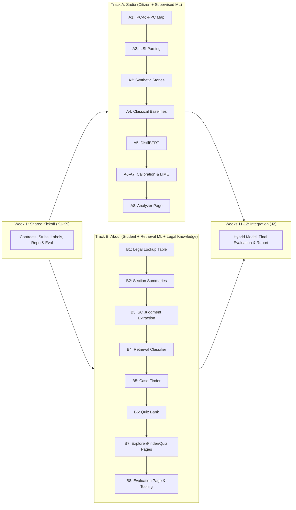
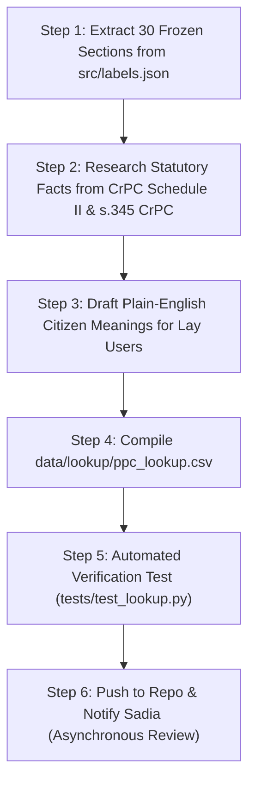

# AI Legal Helper for Pakistan — Implementation Plan (Abdul Qudoos)

**Author:** Abdul Qudoos  
**Collaborator:** Sadia Fatima  
**Course:** Machine Learning (5th Semester BS Computer Science)  
**Document Purpose:** Master execution roadmap for Abdul Qudoos's responsibilities under the **Two Independent Tracks** task division, including kickoff status, track roadmap, and the concrete implementation plan for the next task (**Task B1: Legal Lookup Table**).

---

## 1. Track Architecture & Core Responsibilities

Under the updated task division, the project is structured into two completely independent, parallel tracks designed to eliminate cross-dependencies:

### Abdul Qudoos's Scope (Track B):
1. **Legal Knowledge Foundation:** Authoring the authoritative CrPC Schedule II lookup table (B1), plain-English section summaries, elements of offence, and confusable pair taxonomies (B2).
2. **Supreme Court Judgment Mining:** Exploration and regex-based section citation extraction on Pakistan SC judgments (B3).
3. **Retrieval-Based ML & Case Search:** Building zero-shot sentence-embedding retrieval classifier for section recommendation (B4) and FAISS-based Similar Case Finder (B5).
4. **Student Educational Suite:** Authoring a 60–100 scenario quiz bank (B6) and developing the Streamlit Section Explorer, Case Finder, and Quiz pages (B7).
5. **Evaluation Suite & Error Analysis:** Developing the model evaluation dashboard and comparative error analysis tooling (B8).
6. **Shared Deliverables:** Co-collecting and labelling the real-person test set (J1), and co-building the hybrid model and final defense materials (J2).

---

## 2. Master Task Matrix for Abdul Qudoos

| Task ID | Phase / Weeks | Task Name | Type | Hours | Deliverables | Dependencies / Hand-offs |
| :--- | :---: | :--- | :--- | :---: | :--- | :--- |
| **K1–K9** | **Week 1** | **Shared Kickoff, Contracts & Stubs** | **Setup + ML** | **8h** | Repo, `labels.json`, stubs, `evaluate.py`, app skeleton | Shared with Sadia |
| **B1** | **Weeks 2–3** | **Legal Lookup Table (CrPC Schedule II)** | **Manual / Legal** | **12h** | `data/lookup/ppc_lookup.csv` (all 30 sections) | None (Sadia consumes in Wk 9) |
| **B2** | Weeks 3–4 | Section Summaries, Elements & Confusable Groups | Manual / Legal | 10h | `data/content/sections.json`, `confusable_groups.json` | B1 |
| **B3** | Weeks 4–5 | Supreme Court Judgments Exploration & Regex Extraction | ML (Data) | 10h | `data/processed/sc_clean.csv`, regex precision report | K2 |
| **B4** | Weeks 5–6 | Retrieval Classifier (Sentence Embeddings) | ML | 12h | `src/retrieval.py`, zero-shot results CSV | B2, K7 |
| **J1** | Weeks 6–9 | Real-Person Test Set (Abdul's Half: 100 En + 30 Roman) | Manual | 6h | Part of `data/test/real_test.csv` (frozen) | K2 |
| **B5** | Week 7 | Similar Case Finder (FAISS / Vector Index) | ML | 8h | `src/case_finder.py`, semantic case search API | B3 |
| **B6** | Week 8 | Quiz Bank (60 to 100 Scenarios) | Manual | 10h | `data/content/quiz_bank.json` | B2 |
| **B7** | Weeks 9–10 | Student App Pages (Explorer, Case Finder, Quiz) | App Dev | 14h | `app/pages/2_Section_Explorer.py`, `3_Case_Finder.py`, `4_Quiz.py` | B1, B2, B5, B6 |
| **B8** | Week 10 | Evaluation Page & Error Analysis Tooling | ML + App | 8h | `app/pages/5_Evaluation.py`, `src/error_analysis.py` | K6, K7 |
| **J2** | Weeks 11–12 | Hybrid Model, System Integration, Report & Slides | All | 14h | Hybrid predictor, final report, presentation deck | A6, B4, J1 |

*Total Track Commitment:* **112 Hours** (8h Kickoff + 84h Track B + 6h J1 + 14h J2).

---

## 3. Current Status: What is Done vs. What is Remaining

### 3.1 Completed Items
- [x] **K1 (Repo & Environment):** Standard directory tree initialized (`data/*`, `app/*`, `src/*`, `models/*`, `results/*`, `docs/*`, `tests/*`). [requirements.txt](file:///c:/Users/Microsoft/Desktop/AI-Legal-Helper-for-Pakistan/requirements.txt) and [.gitignore](file:///c:/Users/Microsoft/Desktop/AI-Legal-Helper-for-Pakistan/.gitignore) configured.
- [x] **K2 (PPC Label Space):** [src/labels.json](file:///c:/Users/Microsoft/Desktop/AI-Legal-Helper-for-Pakistan/src/labels.json) frozen with 30 target sections, citizen colloquial terms, legal categories, and confusable cross-references. Verified via unit test.
- [x] **K3 (Data Format Standard):** [data/README.md](file:///c:/Users/Microsoft/Desktop/AI-Legal-Helper-for-Pakistan/data/README.md) defines canonical CSV schema (`id`, `text`, `sections`, `language`, `source`, `split`).

### 3.2 Kickoff Enablers & Stubs (Completed)
- [x] **K4 & K8 (Model Contract & Predictor Stub):** [src/models/stub_model.py](file:///c:/Users/Microsoft/Desktop/AI-Legal-Helper-for-Pakistan/src/models/stub_model.py) exposing `predict_scores(text) -> dict`.
- [x] **K5 & K8 (Lookup Stub):** Initial 5-row placeholder [data/lookup/ppc_lookup.csv](file:///c:/Users/Microsoft/Desktop/AI-Legal-Helper-for-Pakistan/data/lookup/ppc_lookup.csv) so Track A app code never blocks.
- [x] **K7 (Evaluation Engine):** [src/evaluate.py](file:///c:/Users/Microsoft/Desktop/AI-Legal-Helper-for-Pakistan/src/evaluate.py) implementing top-1 accuracy, top-3 recall, and multi-label micro/macro F1 metrics.
- [x] **K8 (Evaluation Stub Sentences):** [data/test/stub_test.csv](file:///c:/Users/Microsoft/Desktop/AI-Legal-Helper-for-Pakistan/data/test/stub_test.csv) (20 test cases).
- [x] **K6 (Results Contract):** [results/stub_model.csv](file:///c:/Users/Microsoft/Desktop/AI-Legal-Helper-for-Pakistan/results/stub_model.csv) generated and validated.
- [x] **K9 (App Skeleton):** [app/Home.py](file:///c:/Users/Microsoft/Desktop/AI-Legal-Helper-for-Pakistan/app/Home.py) and all 5 multi-page templates in [app/pages/](file:///c:/Users/Microsoft/Desktop/AI-Legal-Helper-for-Pakistan/app/pages/).

---

## 4. Deep-Dive Implementation Plan: Next Task (Task B1: Legal Lookup Table)

### 4.1 Task Summary
- **Task ID:** `B1`
- **Owner:** Abdul Qudoos
- **Timeline:** Weeks 2 to 3
- **Estimated Hours:** 12 Hours
- **Goal:** Author the authoritative, verified legal facts table (`data/lookup/ppc_lookup.csv`) covering all 30 PPC sections in `labels.json` sourced directly from Schedule II of the Code of Criminal Procedure (CrPC).
- **Handoff Importance:** Sadia's Incident Analyzer page (Task A8) displays FIR eligibility, bailability, and punishments from this exact file. Providing it early (Week 3) gives Sadia a 6-week buffer.

---

### 4.2 Data Contract Specification for `ppc_lookup.csv` (K5 Contract)

Every row corresponds to one section in `src/labels.json` and must contain exactly these 10 columns:

| Column Name | Type | Permitted Values / Description | Example |
| :--- | :--- | :--- | :--- |
| `section` | string | Exact PPC section number matching `labels.json` | `"392"` |
| `short_name` | string | Brief title of the offence | `"Robbery"` |
| `meaning` | string | Clear 1-line plain-English explanation for lay citizens | `"Taking property by force, fear of injury, or wrongful restraint"` |
| `cognizable` | string | `"Cognizable"` (Police can arrest without warrant / FIR) or `"Non-cognizable"` | `"Cognizable"` |
| `bailable` | string | `"Bailable"` or `"Non-bailable"` | `"Non-bailable"` |
| `compoundable` | string | `"Compoundable"` (Victim can compromise under s.345 CrPC) or `"Non-compoundable"` | `"Non-compoundable"` |
| `punishment` | string | Statutory penalty range under PPC | `"Rigorous imprisonment for 3 to 10 years, and fine; if on highway between sunset and sunrise, up to 14 years"` |
| `court` | string | Competent trial court under Schedule II CrPC | `"Court of Session or Magistrate of the first class"` |
| `source` | string | Official legal reference | `"PPC 1860 & CrPC Schedule II (amended 2023)"` |
| `date_checked` | string | Verification date in ISO format | `"2026-11-18"` |

---

### 4.3 Step-by-Step Execution Plan for B1

#### Step 1: Extract and Initialize Target Sections
Read `src/labels.json` to ensure 100% section parity:
- 30 target sections: `302`, `307`, `319`, `324`, `337-A`, `337-F`, `339`, `340`, `354`, `354A`, `363`, `365`, `365-A`, `379`, `380`, `382`, `384`, `392`, `395`, `403`, `406`, `411`, `420`, `441`, `447`, `448`, `489-F`, `500`, `506`, `509`.

#### Step 2: Extract Procedural Facts from Schedule II of CrPC
For each section, extract the statutory procedural categorisation:
1. **Cognizability (Column 3 of Sched II):** Whether police may arrest without warrant. (Critical for citizen: can an FIR be filed directly at the thana?).
2. **Bailability (Column 5 of Sched II):** Whether bail is a matter of statutory right or court discretion.
3. **Compoundability (s. 345 CrPC):** Can the victim pardon or settle the offence with or without court permission?
4. **Punishment (Column 7 of Sched II & PPC text):** Exact minimum/maximum imprisonment and fine provisions.
5. **Trial Court (Column 8 of Sched II):** Magistrate of 1st class, Magistrate Section 30, Court of Session.

#### Step 3: Write Lay-Friendly Section Meanings
Craft an accessible, jargon-free 1-line definition for ordinary citizens (e.g. for Section 489-F: *"Dishonestly issuing a cheque that bounces due to insufficient funds"*).

#### Step 4: Author `data/lookup/ppc_lookup.csv`
Compile all rows into the CSV format, ensuring UTF-8 encoding and clean comma separation with quoted strings where commas appear.

#### Step 5: Implement Automated Schema & Completeness Test (`tests/test_lookup.py`)
Write an automated unit test verifying:
- Exactly 30 rows matching `src/labels.json`.
- No empty strings across any of the 10 required columns.
- Valid enum values: `cognizable` in `{"Cognizable", "Non-cognizable"}`; `bailable` in `{"Bailable", "Non-bailable"}`; `compoundable` in `{"Compoundable", "Non-compoundable"}`.

---

### 4.4 Deliverables & Definition of Done for Task B1
- [ ] `data/lookup/ppc_lookup.csv` authored with all 30 PPC sections populated across all 10 columns.
- [ ] Every entry backed by an official statutory source citation and check date.
- [ ] Unit test `tests/test_lookup.py` passing with 100% coverage of lookup rows.
- [x] Initial kickoff stubs (K4, K5, K7, K8, K9) generated so the team repository is completely operational.
- [ ] Committed and pushed to Git under branch `aq/b1-lookup-table`.
