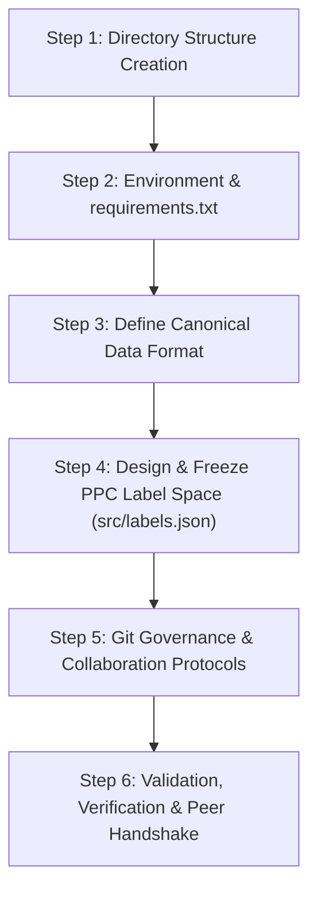

# AI Legal Helper for Pakistan — Implementation Plan (Abdul Qudoos)

**Author:** Abdul Qudoos (Team Lead, Reg No: 023-24-0233)  
**Collaborator:** Sadia Fatima (Reg No: 023-24-0213)  
**Course:** Machine Learning (5th Semester BS Computer Science)  
**Document Purpose:** Master execution roadmap for Abdul Qudoos's responsibilities, with detailed, step-by-step implementation instructions starting with **Task 1 (J1: Project Setup and Label Space)**.

---

## 1. Executive Summary & Team Responsibilities

### 1.1 Abdul Qudoos's Role Profile
As **Team Lead** and **ML Architecture Lead**, Abdul Qudoos is responsible for:
1. **Core Data Engineering:** Parsing Indian LeSICiN/ILSI datasets (A1), validating legal parity via IPC-to-PPC cross-mapping (A2), and co-curating synthetic & real test datasets (J1, J2, J4).
2. **Model Training & Classical Baselines:** Preprocessing pipeline with Roman Urdu normalisation, TF-IDF n-grams, class-balanced Logistic Regression, Linear SVM, and Naive Bayes baselines, including ablation studies (A3).
3. **Deep Learning:** Multi-label transformer fine-tuning (DistilBERT / Legal-BERT) with sigmoid heads on Google Colab (A4).
4. **Trust & Safety Engineering:** Confidence calibration (temperature/Platt scaling), coverage vs. accuracy curves, and "abstain/not sure" thresholding (A5).
5. **Citizen-Facing Legal Assistance & Product Delivery:** Plain-English Next Steps & FIR filing procedures with verified helplines (A6), and Streamlit Incident Analyzer page with inference backend (A7).
6. **Project Management:** Repository governance, pull request reviews, weekly check-in documentation (`docs/meetings.md`), and demo coordination (J1, J5).

---

## 2. High-Level Master Task Matrix (Abdul Qudoos)

| Task ID | Phase / Week | Task Name | Type | Est. Hours | Primary Deliverables | Dependencies |
| :--- | :---: | :--- | :--- | :---: | :--- | :--- |
| **J1** | **Week 1** | **Project Setup, Git Governance & Label Space (Lead)** | **Setup + Legal** | **6h** | Repo skeleton, `requirements.txt`, `src/labels.json`, data standard doc | None |
| **A1** | Week 2 | LeSICiN (ILSI) Parsing & Filtering | ML (Data) | 12h | `data/processed/ilsi_clean.csv`, summary statistics | J1, A2 |
| **A2** | Week 3 | IPC-to-PPC Mapping Table | Manual / Legal | 8h | `data/mapping/ipc_ppc_map.csv` | J1 |
| **J2** | Week 4 | Synthetic Incident Stories & Verification (50% share) | Manual + ML | 10h | Half of `data/processed/synthetic.csv` | J1 |
| **J3** | Week 4 | Shared Evaluation Framework (`evaluate.py`) | ML | 4h | `src/evaluate.py`, unit test | J1 |
| **A3** | Week 5 | Preprocessing & Classical Baselines (LR, SVM, NB) | ML | 14h | `src/preprocess.py`, baseline models, ablation tables | A1, B1, J2, J3 |
| **A4** | Weeks 6–7 | Transformer Fine-Tuning (DistilBERT / Legal-BERT) | ML | 16h | Colab training scripts, saved checkpoints, multi-label metrics | A3, J3 |
| **A5** | Week 8 | Confidence Calibration & Abstain Logic | ML | 6h | Calibration plots, reliability diagrams, threshold module | A4, B4 |
| **J4** | Weeks 8–10 | Real-Person Test Set Collection & Annotation | Manual | 6h | `data/test/real_test.csv` (co-annotated & frozen) | J1, B2 |
| **A6** | Week 9 | Next Steps Guides & Verified Helplines | Manual / Content | 6h | `docs/next_steps.md`, `data/lookup/helplines.csv` | J1 |
| **A7** | Weeks 9–10 | Streamlit Incident Analyzer & Inference Engine | App Dev | 10h | `src/predict.py`, `app/pages/1_Incident_Analyzer.py`, test suite | A5, B2, A6 |
| **J5** | Weeks 11–12 | Integration, System Testing, Slides & Viva Prep | All | 14h | Working end-to-end app, slide deck, demo script | All |

*Total Core Commitment:* **112 Hours** across 12 weeks.

---

## 3. Deep Dive: Implementation Plan for Task 1 (J1: Project Setup and Label Space)

### 3.1 Task Overview
- **Identifier:** `J1`
- **Owner:** Abdul Qudoos (Lead) & Sadia Fatima
- **Target Timeline:** Week 1
- **Estimated Effort:** 6 hours (Abdul)
- **Goal:** Establish the standardized code, data, and environment infrastructure, configure Git collaboration standards, and freeze the 25–40 PPC legal label taxonomy in `src/labels.json`.

---

### 3.2 Step-by-Step Execution Plan



#### Step 1: Initialize Directory Tree
Create the standard directory layout for the project to separate raw data, processed assets, training source code, models, documentation, and the Streamlit frontend.

```text
AI-Legal-Helper-for-Pakistan/
├── app/                        # Streamlit web application
│   ├── app.py                  # Home / entrypoint
│   └── pages/                  # Multi-page views (Analyzer, Explorer, etc.)
├── data/
│   ├── raw/                    # Untouched external datasets (SC, LeSICiN)
│   ├── processed/              # Cleaned, tokenized CSVs (ilsi_clean, sc_clean, synthetic)
│   ├── mapping/                # IPC-to-PPC crosswalks
│   ├── lookup/                 # CrPC Schedule II tables, verified helplines
│   ├── content/                # Plain-English summaries & confusable pairs
│   └── test/                   # Frozen real-person test evaluation set
├── docs/                       # Project documentation, meeting notes, guides
├── models/                     # Serialized artifacts (TF-IDF, pickle, checkpoints)
├── notebooks/                  # Colab & local exploratory analysis
├── results/                    # CSVs, confusion matrices, evaluation metrics
├── src/                        # Core reusable Python package
│   ├── __init__.py
│   └── labels.json             # Canonical PPC section label dictionary
├── .gitignore
├── README.md
├── requirements.txt
└── implementation_plan-AQ.md
```

#### Step 2: Configure Python Virtual Environment & `requirements.txt`
Specify fixed or compatible versions of all dependencies to ensure seamless portability across local Windows environments and Google Colab GPUs.

**Key Packages to Include:**
- **Machine Learning & Classical NLP:** `scikit-learn>=1.3.0`, `numpy>=1.24.0`, `pandas>=2.0.0`, `scipy>=1.11.0`, `joblib>=1.3.0`
- **Deep Learning & Transformers:** `torch>=2.0.0`, `transformers>=4.35.0`, `sentence-transformers>=2.2.2`, `accelerate>=0.24.0`
- **Vector Search & Similarity:** `faiss-cpu>=1.7.4`
- **Explainability & Trust:** `lime>=0.2.0`, `matplotlib>=3.7.0`, `seaborn>=0.12.0`
- **Web Interface:** `streamlit>=1.28.0`
- **Testing & Quality:** `pytest>=7.4.0`, `python-dotenv>=1.0.0`, `tqdm>=4.66.0`

#### Step 3: Establish Shared Dataset Format Standard (`data/README.md`)
To ensure that all four data sources (`sc`, `ilsi`, `synthetic`, `real`) merge seamlessly into the ML pipelines, standardize the schema:

| Column Name | Data Type | Permitted Values / Description | Example |
| :--- | :--- | :--- | :--- |
| `id` | string | Unique identifier (`syn_001`, `ilsi_104`, etc.) | `"syn_042"` |
| `text` | string | The incident narrative (raw or lightly cleaned) | `"Two boys snatched my mobile phone on gunpoint."` |
| `sections` | string (JSON array) | List of valid PPC sections as strings | `["392", "34"]` |
| `primary_section` | string | Single most prominent section | `"392"` |
| `language` | string | `"en"` (English) or `"roman_ur"` (Roman Urdu) | `"en"` |
| `source` | string | `"sc"`, `"ilsi"`, `"synthetic"`, or `"real"` | `"synthetic"` |
| `split` | string | `"train"`, `"val"`, or `"test"` | `"train"` |

#### Step 4: Curate and Freeze PPC Label Space (`src/labels.json`)
The legal scope will be frozen at **30 carefully selected PPC sections** that represent:
1. **High-Frequency Citizen Incidents:** Street theft, robbery, cheque bounce, online fraud, assault, intimidation.
2. **Critical Confusable Pairs for Law Students:**
   - *Theft vs. Robbery vs. Dacoity:* 379 vs. 392 vs. 395
   - *Breach of Trust vs. Cheating vs. Bad Cheque:* 406 vs. 420 vs. 489-F
   - *Hurt & Bodily Harm Levels:* 319 vs. 324 vs. 337-A vs. 337-F
   - *Modesty & Assault on Women:* 354 vs. 354A vs. 509
   - *Trespass vs. House-breaking:* 441 vs. 447 vs. 448

**Structure of `src/labels.json`:**
Each entry contains:
- `section`: PPC section number (e.g., `"392"`)
- `title`: Formal legal title (e.g., `"Punishment for robbery"`)
- `category`: Legal category (e.g., `"Property Offences"`)
- `citizen_term`: Common colloquial term (e.g., `"Armed snatching / Robbery"`)
- `confusable_with`: List of related section numbers (e.g., `["379", "395"]`)
- `in_ilsi`: Boolean flag indicating if direct IPC counterpart exists for transfer learning

#### Step 5: Git Governance & Collaboration Protocols
1. **Branching Model:**
   - `main`: Production-ready code; protected against direct commits.
   - `aq/<task-name>`: Abdul's feature branches (e.g., `aq/j1-setup`, `aq/a1-ilsi-parser`).
   - `sf/<task-name>`: Sadia's feature branches (e.g., `sf/b1-sc-extraction`).
2. **Pull Request Protocol:**
   - Every PR must have at least one approval from the other peer before merge.
   - Legal tables (`ipc_ppc_map.csv`, `ppc_lookup.csv`) require 100% mutual review.
3. **Weekly Sync Log:**
   - Maintain `docs/meetings.md` logging: date, agenda, blockers, task status, next milestone.

---

### 3.3 Deliverables & Definition of Done for Task J1
- [x] Folder structure initialized and committed to the workspace.
- [x] `requirements.txt` validated with standard dependencies.
- [x] `data/README.md` created defining the dataset schema with concrete examples.
- [x] `src/labels.json` authored with 30 target PPC sections, categories, and confusable references.
- [x] `.gitignore` configured to ignore raw heavy files, python bytecode, virtual environments, and temporary logs.
- [x] Initial smoke test (`tests/test_labels.py`) verifying that `src/labels.json` parses cleanly and contains no duplicate section IDs.
- [x] Milestone review shared with Sadia for sign-off.

---

## 4. Immediate Next Step
Task J1 has been completed and verified. The next task on the schedule is:
- **Task A1 (Week 2):** LeSICiN (ILSI) Parsing and Filtering.
- **Task A2 (Week 3):** IPC-to-PPC Mapping Table (`data/mapping/ipc_ppc_map.csv`).
